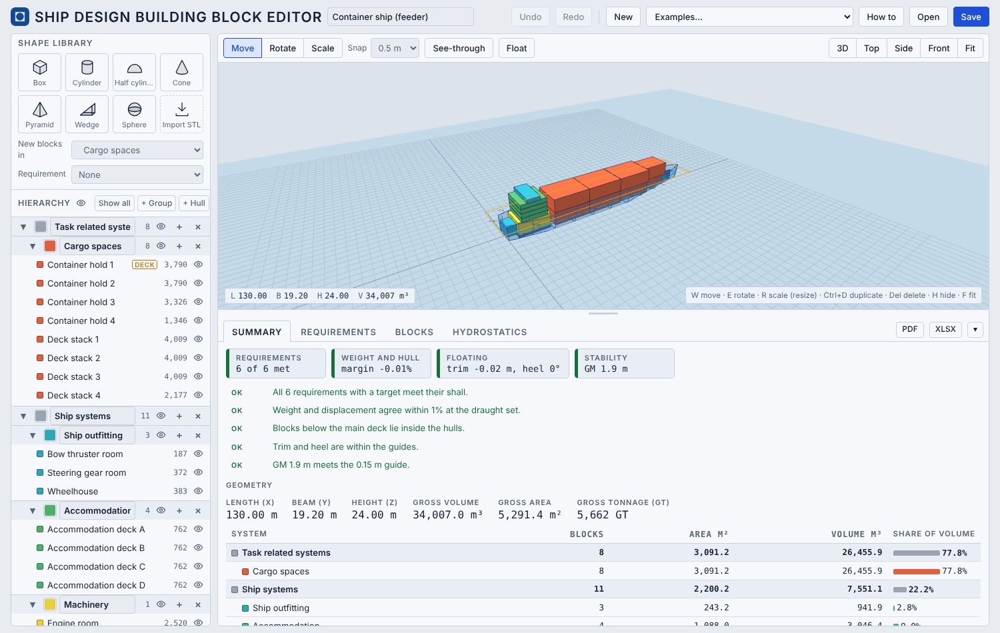
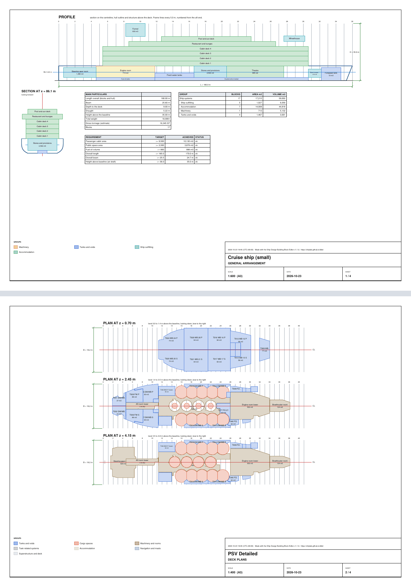

# Ship Design Building Block Editor

**A small 3D editor for teaching early-stage ship design, inspired by the Design Building Block (DBB) approach.**

**Open the app: https://shiplab.github.io/dbb/**



> **For educational use only.** The hulls are illustrative parametric shapes, not real lines. Weights, hydrostatics, trim, heel and stability are simplified estimates, and the righting lever is drawn only up to the angle where the deck edge enters the water. The results must not be used for design approval, class or flag-state documentation, or any safety-critical decision. The software is provided as it is, without warranty.

**Course compendium.** `docs/compendium.md` (and `docs/compendium.pdf`) is a step-by-step course: requirements, blocks, hull, floating and stability, the other tabs, experiments, the What if tab, outputs and a final exercise, with answers. The finished design of its first chapters is `docs/coastal-cargo-vessel.json`.

## What it is

The Design Building Block (DBB) approach builds a ship design from physical blocks (volumes and areas) that are grouped by function and linked to requirements. This app is a deliberately simple "Tinkercad for DBB". You place and shape blocks in 3D, give each one a group, a requirement and a density, and the tables sum up volume, area, weight and centres of gravity. An illustrative hull, floating at the weight, gives a first check of draught, trim, heel and initial stability.

It is an editor and calculator for the early stage. In a course it fits after Systems Based Ship Design (SBSD): the spaces that come out of the system breakdown become the first blocks.

## What it does

- **3D blocks** from seven primitive shapes (box, cylinder, half-cylinder, cone, pyramid, wedge, sphere). Move, rotate and scale them with the gizmo, or type exact size, position and rotation. The scale handles keep the opposite face fixed. Snapping aligns block faces.
- **Import STL.** Press **Import STL** in the shape library, or drop an STL file on the workplane: one file becomes one block. Units are guessed and can be changed. Large files (up to 500 MB) are reduced on import to a few thousand triangles, so the project file stays small, while volume, centre of gravity and plan area come from the real mesh. Imported shapes are saved inside the project JSON (up to 500 per project; a shape that no block uses is not saved), and they do not add icons to the shape library. The right panel shows the selected block or hull and gives its width back to the 3D view when nothing is selected.
- **Free groups.** The default is the offshore support vessel breakdown by Levander (task related systems and ship systems). Groups can be renamed, recoloured, nested, added and deleted.
- **Requirements** with the shall/should convention. Each has a metric (volume, area, weight, length, beam, height, total weight or gross tonnage), a direction (at least or at most) and two target values. Volume, area and weight requirements count the blocks linked to them, and a block can serve several requirements. Length, beam, height, total weight and gross tonnage come from the whole design. The status is red when the shall is not met, green between shall and should, and orange beyond the should (an excess), with the margin.
- **Illustrative hulls** (optional, one or more): press **+ Hull**. Types: offshore vessel, research vessel, cargo ship, slender demihull and barge. A second **+ Hull** makes a catamaran and a third a trimaran, up to five hulls, each fitted to its own group of blocks. Each hull is fitted around the blocks below the main deck (its *depth*), which a block can define with the **Defines main deck** tick; blocks above it stay outside. The hull can be moved, scaled and reshaped with sliders (flat bottom, bilge, flare, parallel body, bow, stern). Hull and water colours can be chosen.
- **Hull from a table of offsets.** Pick **Gunnerus-like (table)** as the hull type, or press **Hull from table…** in the hull panel to add a hull from a CSV file or a pasted table (stations and heights in metres, half-breadths in the cells, blank = no hull). The table copied from the **Offsets** button can be imported again. For a table hull, **Fit to blocks** scales the length and beam of the table (not uniformly) to the blocks below the main deck; the depth and the shape of the lines are kept.
- **Draught and water.** One draught for the whole vessel, shown as a water surface. The hydrostatics are calculated at the draught: displaced volume, displacement, LWL, BWL, Cb, Cp, Cm, Cwp, Awp, LCB, KB, LCF and TPC, with an editable water density.
- **Float.** With **Float** on, the draught, trim and heel follow the weight as you move blocks. The trim and heel are an exact tilted water plane on the hull shapes, drawn in 3D with draught marks and a live readout.
- **Initial stability.** KB, BM (from the waterplane of all hulls, so multihulls are handled), KM and GM, transverse and longitudinal. Blocks can be marked **Free surface** (partly filled liquid tanks) and the correction is subtracted from GM. A few basic checks are shown: GM at least 0.15 m, static heel at most 5 degrees and trim at most 1% of the length. These are guides, not a stability assessment.
- **Righting lever (GZ).** Below the initial stability, the Hydrostatics tab draws GZ against the heel angle in steps of 5 degrees, with the trim free, from the real hull shape. The curve ends where the deck edge enters the water, because buoyancy above the main deck is not modelled. It lists the maximum GZ, its angle and the usual IMO criteria (areas to 30 and 40 degrees, GZ at 30 degrees, angle of maximum GZ, GM), for guidance only. The same curve and table are in the PDF and in a GZ sheet of the Excel file.
- **Walkable view and evacuation data.** In the **Evacuation** section of the right panel, give a block a role (room, corridor, open deck, stair, muster station or obstacle) with its doors, berths and persons. **Walkable** (above the 3D view) shows the floors, walls with door gaps, doors, stairs and persons per space, by the rules of the Ship Evacuation tool (NTNU); problems such as a room with no way out appear as Check in the Summary. The data is saved in the project file and kept when it goes through the evacuation tool. The **Simulation** button in the top bar opens a second workspace that runs the evacuation on the layout (persons walk in the 3D view as low-poly figures or cylinders, in standard or vibrant colours, at a chosen speed, with density maps and charts; arrival time, density and congestion are saved in the project; fire and flood sources spread through the doors of the layout and catch the persons they reach), and two requirement metrics use it: persons on board and the 95% evacuation time. Examples are in `examples/evac/`, and *SOV with evacuation scenario* is in the Examples list.
- **Grid and placement aids.** The grid follows the Snap step (1 m when snap is off), with heavier lines every 10 m and numbered marks along x and y. A shape dragged from the library shows its footprint and x, y, z range where it will land, and a selected block shows its footprint and drop lines on the grid.
- **Maximize.** The **Maximize** button in the 3D toolbar (or M) gives the 3D view the whole window. **Restore**, M or Esc goes back.
- **Hull view.** Press **Hull** (beside Float, or Shift+H), or **Hull view…** in the hull panel, to edit its shape with curves, full screen (a hull is added first if there is none): the sheer plan, the half-breadth plan and the body plan (tools Drag, Click and Draw; add or delete body-plan sections), a live 3D hull with the blocks shown faintly inside, shape sliders (flat of bottom, bilge radius, parallel middle body, forebody fullness, stem rake, stern type), a bulbous bow, a choice of eleven starting hulls and the hydrostatics. **Apply** replaces the hull, **Cancel** leaves it. The result is a *curves hull*: a table of offsets that keeps its curves, so it can be edited again and works everywhere else (hydrostatics, resistance, exports); the drawn bulb feeds the resistance. A hull without curves starts as a close copy of its shape, with the volume difference shown.
- **Resistance (Holtrop).** A **Resistance** tab beside Hydrostatics, always on when there is a hull. It draws the total resistance against speed (Froude number along the top) with a marker at the service speed, and lists the parts at that speed: frictional, form, appendage, wave, bulbous, transom and correlation. Set the service speed (the default is Froude number 0.2), the afterbody form and the transom, and tick **Bulbous bow (assumed)** to add a bulb with a default size to the resistance only (it is not drawn). The inputs come from the hull at its draught, so a table hull follows its size fields. It is the Holtrop method for displacement ships, a first estimate for comparing designs. A warning shows when L/B, B/T or Cp are outside its range, and some shapes give no curve. No appendages and no propulsion; with several hulls pick one, and the interaction between hulls is not included. The formulation follows the ShipLab Holtrop web app (Flor, Monteiro and Gaspar), the same code as the [Hull Generator](https://shiplab.github.io/hull/).
- **Seakeeping.** A **Seakeeping** tab beside Resistance gives the heave, pitch, vertical motion and vertical acceleration, the wave bending moment and the roll of the hull in regular waves, against wave frequency. It is the closed-form method of Jensen, Mansour and Olsen (2004): the ship is a box of the waterline length and draught with a breadth of waterline breadth times Cb. Set the speed (the same as in Resistance), the wave heading (180° is head waves), the wave amplitude, the position along the ship where the vertical motion is read (0 is the centre of gravity, 100 the bow), and for roll the damping, the natural period and the prismatic length ratio; GM comes from the Hydrostatics tab unless typed. A chart, or a band of it, turns pink outside the limits of the method: beam waves, B/T, Cb, Froude number, the prismatic length ratio, heave for waves longer than the ship, pitch for wave lengths near the ship length, and roll near the resonance. Below the charts, a sea state (Hs, Tz or Tp, JONSWAP peak factor γ, duration) gives the RMS, significant and most probable maximum of heave, pitch, vertical motion and acceleration at the position, and roll; the wave and response spectra; and, against motion limits (NORDFORSK and NATO presets, all editable), the limiting Hs and its change with the heading. One sea state, no scatter diagram, no bending moment; seakeeping of multihulls is not possible (with several hulls, one is taken alone). The formulation follows the ShipLab ship motion web app. The code is checked equal to that app by `dev/test-seakeeping.js`. Motion sickness: MSDV with the ISO 2631-1 weighting Wf (checked against Taylor 2023, Stellenbosch University) and VI = MSDV/3, with ABS 30 and 6 h 45 m/s^1.5 limit presets, and the limiting Hs against heading. Sea-state statistics follow sections 7 and 8 of the paper; the limits are those quoted by Stevens and Parsons (2002), Marine Technology 39(1).
- **Blocks against hulls.** For every block, requirement and total, the app estimates how much volume lies outside the hulls, and the volume and area requirements also show the part inside.
- **Mass and centres of gravity.** Density is set per group (a subgroup follows its parent) and can be overridden per block, with a fill percentage for tanks or a typed mass. The centre of gravity of each block is the centroid of its shape. Hull steel, piping and cabling are taken as a share of the displacement, spread over the hull volume. The weight balance compares total weight with displacement: margin, LCG, TCG, VCG and LCG minus LCB.
- **Summary with an assessment.** The Summary tab opens with chips for requirements, weight and hull, floating and stability, then a list of problems, notes and what passes, each linking to where to look. Below it are the geometry and the hulls.
- **Tables** that update as you edit. *Requirements* shows "Meets should", "Meets shall" or "Not met". *Blocks* lists every block, with switchable column sets (Geometry, Mass, Hull), sortable columns, and editable density and fill. *Hydrostatics* holds the floating condition, the weight balance, the weight by group (densities can be edited here), the initial stability and the hull hydrostatics. The tables panel can be resized by dragging.
- **Gross tonnage (GT).** An estimate by the 1969 Tonnage Convention, GT = K1 × V, from the blocks that count as enclosed spaces (untick **Counts for GT** on open spaces). It can be used as a requirement. It is not a tonnage certificate.
- **PDF report.** The **PDF** button writes a report: a perspective view and side, top and front drawings, the assessment, requirements, systems, hulls, weights, floating condition, hydrostatics, stability, the GZ curve, the Holtrop resistance, the seakeeping estimate, assumptions and an appendix listing every block. Every page shows in portrait: the wide pages (the block list and the GA sheets) are turned in the file, so turn your head or the page to read them. The GA drawing sheets are added at its end.
- **Structure.** A **Structure** tab (single hull) gives a first check to the DNV Rules for Ships, Pt.3 Ch.2 (January 2015, ships under 100 m; warning above 100 m). The weights (blocks, and the structure spread with the hull section area) and the buoyancy at the floating position of the Float state give the load, shear force and bending moment along the ship (sagging positive; the end residual is removed linearly). Sec.4 gives the rule stillwater moment, the wave moment in sagging and hogging, the required section modulus Z = (M_S + M_W)/175 and the minimum Z0, with the steel grade (NV-NS to NV-40, f1), the service area (R0 to RE) and a corrosion addition. A midship section built from plate thicknesses, spacings and flat-bar or T longitudinals (with optional double bottom, hatch share and web spacing) gives the neutral axis, the moment of inertia and the modulus at deck and bottom against the requirement; **Size to the rules** gives a start. The local table checks bottom, side and deck plating and longitudinals, the keel plate and the inner bottom minimum (Sec.3, 5, 6, 7) with the pressures, stresses, required and chosen sizes. A steel weight (section area times length times an allowance factor) can replace the structure share in the weights (switch, default off). Not covered: multihulls, bulkheads, floors, girders, frames, buckling, shear strength, fatigue, superstructures. Educational, not a class check.
- **What if.** The **What if** tab opens a window that proposes a change to meet one requirement: it scales the blocks linked to the requirement (in length, beam, depth or a combination, as ticked) to a target between the shall and the should, moves the blocks beyond, and lets the hulls follow, then settles the ship at its level draught. Options (original, to the shall, midway, to the should) are ready to click. The 3D view shows the original in a light colour beside the variants, and the table and bar plots compare weight, stability, main dimensions, coefficients and every requirement. Up to five variants can be saved in the project with an optional name, compared, shown or hidden, applied or deleted. They are in the project file, the PDF report and a Variants sheet of the Excel file. The PDF shows small 3D pictures of the original and the saved variants with their L x B x D, L/B, B/T, L/D, weight, draught and GM (with none saved, it shows the options of the What if tab instead), and a table, worked out when it is made, of what each requirement (up to six) would ask of the ship at its shall and at its should. One requirement is changed at a time, and nothing is re-arranged.
- **Save and open** projects as JSON. **XLSX** exports the whole project as an Excel workbook (Summary, Project, Output, Blocks, Weight, Hydrostatics, GZ, Resistance, Seakeeping, Structure, Variants when saved, Offsets, Requirements) with the group colours, and formulas for the block masses, totals and gross tonnage. Nothing is stored in the browser, so save before you leave.
- **GA drawing** makes a general arrangement on A3 sheets, as DXF (for CAD programs) or as a white PDF. It uses only what the model contains: the profile with the hull and the blocks, a section at amidships, tables of the main particulars, groups and requirements, one plan for each deck level found in the blocks, and, when there is a hull, a lines plan (sheer, half-breadth and body plans). Doors, stairs and equipment are not drawn. The DXF is at full size in millimetres, with one layer per group and the sheets side by side; plot it at the scale in the title block. The files are named `GA_<name>`. In the Claude artifact the DXF is saved inside a zip file, because that page cannot save .dxf. Every PDF page and the DXF carry a stamp with the date, time and UTC offset, the tool name, its version and its address (`APP_VERSION` and `APP_URL` in `core.js`).
- **Examples** from the menu, each with only the groups it uses: Simple (5 blocks), Catamaran (9 blocks, 2 hulls), Trimaran (10 blocks, 3 hulls), R/V Gunnerus (15 blocks, simplified), R/V Gunnerus, STL parts (45 blocks, every visible block an STL part of the vessel; the STL files are in `examples/gunnerus-parts`), PSV (20 blocks), Container ship, feeder (19 blocks, the default), Tanker, double hull (22 blocks), AHTS, anchor handling tug supply (42 blocks, with winches, A-frame and chain lockers), Bulk carrier, handysize (19 blocks), Cruise ship, small (17 blocks), Sailing yacht, 15 m (13 blocks), PSV Detailed (208 blocks with many shaped tanks, no hull), and PSV with STL parts (a crane, a funnel and an A-frame imported from STL files).
- **How to** in the app: a quick start, all keyboard shortcuts, a glossary of the terms used, and an About tab with the disclaimer. Table headings also explain themselves on hover.

The GA drawing, with sheet 1 of the cruise ship example and a deck-plan sheet of PSV Detailed:



## How to use it

1. **Start from your systems.** Each system that needs volume or deck area becomes a block. Use **New**, or open an example from the **Examples** menu.
2. **Set up groups** in the hierarchy on the left. Rename, recolour, add or delete them to match your own division.
3. **Write requirements** in the **Requirements** tab: choose a metric, at least or at most, and the shall and should values. To link a block to several requirements, tick them in the block panel.
4. **Pick the group and requirement** for new blocks in the two menus under the shape library.
5. **Add blocks** by clicking a shape or dragging it onto the workplane (dropping onto a block places it on top).
6. **Shape them.** Select a block and use **Move**, **Rotate** or **Scale**. To resize, choose Scale and drag the small coloured cubes (the opposite face stays fixed), or type L, B and H in the right panel. **Import STL** adds your own shape.
7. **Add a hull (optional).** Press **+ Hull** (a second makes a catamaran, a third a trimaran), tick **Defines main deck** on the block whose top is the deck, then click the hull row (or the hull in the 3D view, or the **Hull** button, or Shift+H) to edit it. The **Hull** button adds a hull when there is none. While a hull is selected the blocks are dimmed. Set the draught, open **Shape** for the sliders, and press **Fit to blocks** after moving blocks. The eye next to **Hierarchy** hides all blocks, to look at the hulls alone.
8. **Add weight.** In the **Hydrostatics** tab set a density per group, and override it on a block in the right panel or the Blocks tab, with a fill percentage for tanks or a typed mass. Tick **Free surface** on a part-filled liquid tank. The structure share is set in the same tab.
9. **Float it.** Press **Float** in the toolbar and move blocks: the draught, trim and heel follow, and GM is shown in the readout.
10. **Read the Summary**, follow its links to the details, iterate until the requirements are met, and **Save** the project as JSON, or export it to Excel, to a PDF report, or to a GA drawing (DXF or PDF).

Coordinates: X forward from the aft end, Y to port, Z up from the baseline, in metres.

| Key | Action |
|---|---|
| W / E / R | Move, rotate, scale |
| H | Hide or show the selection |
| F or 5 | Fit the model in the view |
| 1, 2, 3, 4 | 3D, top, side, front view |
| Ctrl+D | Duplicate (a mirrored hull when a hull is selected) |
| Del | Delete the selection |
| Esc | Deselect |
| Ctrl+Z, Ctrl+Shift+Z or Ctrl+Y | Undo, redo |

## Notes on the examples

The R/V Gunnerus example uses the main dimensions and the space areas and tank volumes published at [shiplab.github.io/gunnerus](https://shiplab.github.io/gunnerus/). The block positions are approximate and are not taken from the drawings. The PSV, catamaran, trimaran, container ship, tanker, bulk carrier, cruise ship and sailing yacht examples are illustrative. *R/V Gunnerus, STL parts* is made of STL parts of the 3D model of the vessel (shiplab/gunnerus data, CC BY-NC 4.0, courtesy of polarkonsult and NTNU; weight calculation from the C-JOB documents, CC BY-SA 4.0), with masses calibrated to the weight calculation; the STL files are in `examples/gunnerus-parts`. *PSV Detailed* is a detailed offshore vessel arrangement of about 83 m, with its requirements set to what the model already meets. The crane, funnel and A-frame in *PSV with STL parts* are simplified shapes made for this tool, free to use; the original STL files are in the `examples` folder, so you can try **Import STL** with them. The hull of the Gunnerus example, called *Gunnerus-like*, comes from an approximate table of offsets of the vessel (shiplab/gunnerus data, CC BY-NC 4.0, courtesy of polarkonsult and NTNU), so it is close to, but not exactly, the real hull. The hulls of the smaller examples are fitted automatically around the blocks; in the container ship, tanker and bulk carrier the blocks are fitted to the hull instead. Densities, fills and draughts in the examples are chosen so that each floats level with a sensible weight margin; they are not measured data.

## Citation

The approach and the tool are two different things, and they are cited separately.

**The approach.** If you use or refer to the Design Building Block approach, cite the paper:

Gaspar, H.M., Fonseca, Í.A. and Andrews, D. *Wither now the Design Building Block (DBB) Approach.* International Marine Design Conference (IMDC 2024). https://doi.org/10.59490/imdc.2024.915

```bibtex
@inproceedings{gaspar2024dbb,
  author    = {Gaspar, Henrique M. and Fonseca, {\'I}caro A. and Andrews, David},
  title     = {Wither now the Design Building Block ({DBB}) Approach},
  booktitle = {International Marine Design Conference (IMDC 2024)},
  year      = {2024},
  doi       = {10.59490/imdc.2024.915}
}
```

**The tool.** If you use the Ship Design Building Block Editor itself, for example in teaching material, a report or a thesis, cite the software:

Gaspar, H.M. (2026). *Ship Design Building Block Editor* [Computer software]. NTNU. https://shiplab.github.io/dbb/

```bibtex
@software{gaspar2026dbbeditor,
  author       = {Gaspar, Henrique M.},
  title        = {{DBB} Block Editor},
  year         = {2026},
  note         = {Web application for teaching early-stage ship design, inspired by the Design Building Block approach},
  organization = {NTNU},
  url          = {https://shiplab.github.io/dbb/}
}
```

## Credit and acknowledgements

Developed by Henrique Gaspar, NTNU, October 2026. It is inspired by the Design Building Block approach of University College London and builds on many earlier developments of the Ship Design and Operations Lab, NTNU, starting with a block layout prototype from 2015. The evacuation layout rules follow IMO MSC.1/Circ.1533 and come from the Ship Evacuation tool of NTNU.

Thanks to the colleagues, students and collaborators at NTNU, University College London (UCL) and other institutions whose ideas, code, data, testing and feedback shaped this app. The manual credits them in more detail.

## Manual

Full reference manual (theory, assumptions, file formats, screenshots): [docs/manual.pdf](docs/manual.pdf). The same text as Markdown: [docs/manual.md](docs/manual.md). Rebuild the PDF with `node dev/manual-pdf.js`.
