# Ship Design Building Block Editor: Course Compendium

**Version 1.3.0 · November 2026**

Henrique M. Gaspar, NTNU · https://shiplab.github.io/dbb/

A step-by-step course on designing a small ship with the Ship Design Building Block Editor: from the first requirement to the blocks, the hull, the checks in each tab, and the use of the design to learn how the requirements shape the ship. The *Manual* explains what each part of the app does and how it is calculated. This compendium teaches by doing, and every number quoted was produced by following the steps.

> **Note.** An AI (Claude, Anthropic) developed this compendium step by step, working with the author, who set the content and reviewed it. The numbers come from following the steps in the app, and you should check them against your own results. Please report errors or unclear steps at https://github.com/shiplab/dbb.

---

## 0. How to use this compendium

**Order.** The chapters build one design, a small coastal cargo vessel, in this order: requirements (chapter 2), blocks (3), hull (4), floating and stability (5), the other tabs (6), experiments (7), the *What if* tab (8), outputs (9), evacuation (10) and a final exercise (11). Chapters 2 to 5 must be followed in order. Chapters 6 to 10 can be read in any order once the design exists (chapter 10 has its own checkpoint file).

**What is needed.** A current browser (Chrome, Edge, Firefox or Safari) with WebGL, and the address above. Nothing is installed and nothing is stored in the browser: **Save** keeps the work as a file.

**Checkpoint.** The finished design of chapters 2 to 5 is the file `coastal-cargo-vessel.json` in the `docs` folder of the repository. **Open** loads it, to continue from there or to compare with own work. The design with a deck arrangement for chapter 10 is the file `coastal-cargo-vessel-evac.json` in the same folder. Numbers that differ slightly from those in the text usually come from a typing difference in a size or position.

**Conventions.** Buttons and tabs are written in **bold** (**New**, **Float**), tab names in *italics* when they are named in a sentence. Each chapter ends with *What to observe* and with exercises. Short answers are in chapter 12.

**The idea in one paragraph.** A ship is described as a set of *blocks*: boxes, cylinders and other simple shapes that stand for spaces and systems, each with a place, a group and a density. The sum of the blocks gives the volumes, areas, weight and centre of gravity. A hull is fitted around them, and the ship is floated at the draught that carries its weight. *Requirements* state what the ship must provide, with a *shall* (the minimum accepted) and a *should* (the wish), and the design is judged against them at every change. This is the Design Building Block approach, taken to a browser.

---

## 1. The window

Press **New**. The page shows an empty project (Figure 1).

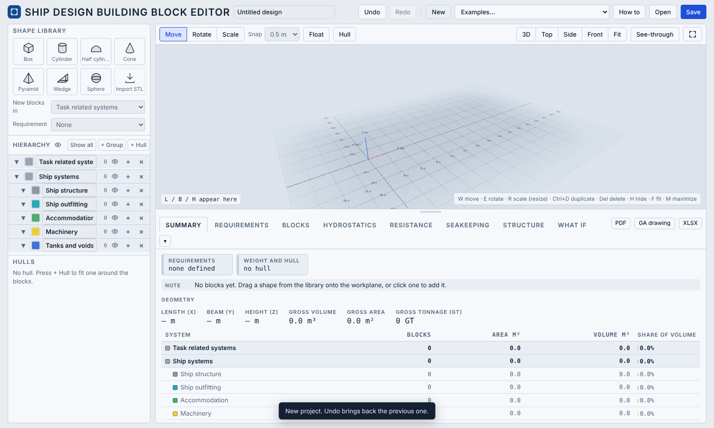

*Figure 1. An empty project.*

- **Shape library** (top left): the shapes that become blocks. Below it are the group and the requirement that new blocks will get.
- **Hierarchy** (left): the groups. *Task related systems* is for the spaces that serve the mission (cargo, for instance) and starts empty. *Ship systems* has the sub-groups that every ship has: structure, outfitting, accommodation, machinery, tanks and voids.
- **3D view** with its toolbar: **Move**, **Rotate** and **Scale** for the selected block, **Float** and **Hull** for the hull, and the standard views.
- **Tabs** under the 3D view: *Summary*, *Requirements*, *Blocks*, *Hydrostatics*, *Resistance*, *Seakeeping*, *Structure* and *What if*.

**Try.** Drag on the 3D view to orbit, right-drag to pan and use the wheel to zoom. The buttons **3D**, **Top**, **Side**, **Front** and **Fit** give standard views.

**Name the design.** Type *Coastal cargo vessel* in the name field at the top.

---

## 2. Requirements

The design starts from what the ship is for. Three requirements are enough for a first ship.

| Requirement | Metric | Sense | Shall | Should |
|---|---|---|---|---|
| Cargo volume | Volume | at least | 400 m³ | 600 m³ |
| Accommodation area | Area | at least | 70 m² | 100 m² |
| Overall length | Overall length (X) | at most | 32 m | 30 m |

**Steps.**

1. Open the **Requirements** tab and press **+ Requirement** three times.
2. In each row type the name, choose the metric and the sense, and type the shall and the should.

*Volume* and *Area* count the blocks linked to the requirement. *Overall length* is read from the design as a whole, so no block has to be linked.

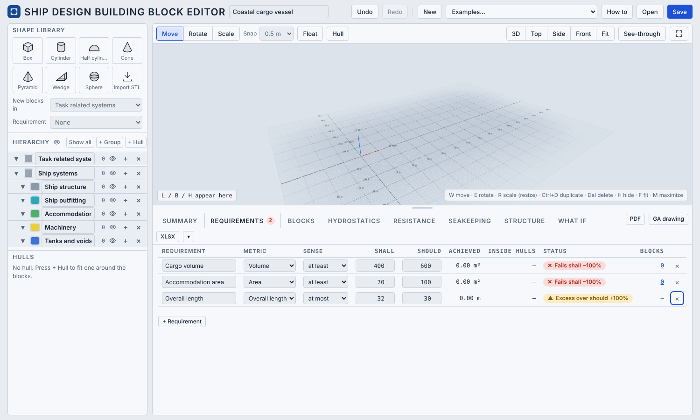

*Figure 2. The three requirements, before any block exists.*

**Shall and should.** The *shall* is the limit below which the design is not accepted (for "at most", above which). The *should* is the wish. A design between the two is acceptable, and a design beyond the should is in excess: more than was asked for, usually at a cost somewhere else.

**What to observe.** The status is red (shall not met) for volume and area, because no block is linked yet, and orange for the length: with no blocks the length is zero, which is within the limit and beyond the wish, an excess that means nothing yet. A status is meaningful only when the blocks are there.

**Exercises.**

1. Why is *Cargo volume* a requirement "at least" and *Overall length* "at most"?
2. Change the shall of the cargo volume to 800. Does the status change? Restore 400.

---

## 3. Blocks

### 3.1 A group for the cargo

The cargo space belongs to the task of the ship, not to the ship systems. In the hierarchy press **+** on the row *Task related systems* to add a sub-group, and name it *Cargo spaces*.

### 3.2 The first block

1. Open the **Blocks** tab. In the shape library, below *New blocks in*, choose the group *Cargo spaces* and, below *Requirement*, choose *Cargo volume*.
2. Click **Box**. A box appears, selected, and the panel on the right shows its properties.
3. Type the name *Cargo hold*, the size 18 × 8 × 3.5 m (L, B, H) and the centre 21, 0, 1.75 m (X from the stern, Y from the centreline, Z from the baseline).
4. Type 55 in **Fill %**: the hold is filled to 55% of its volume with cargo.

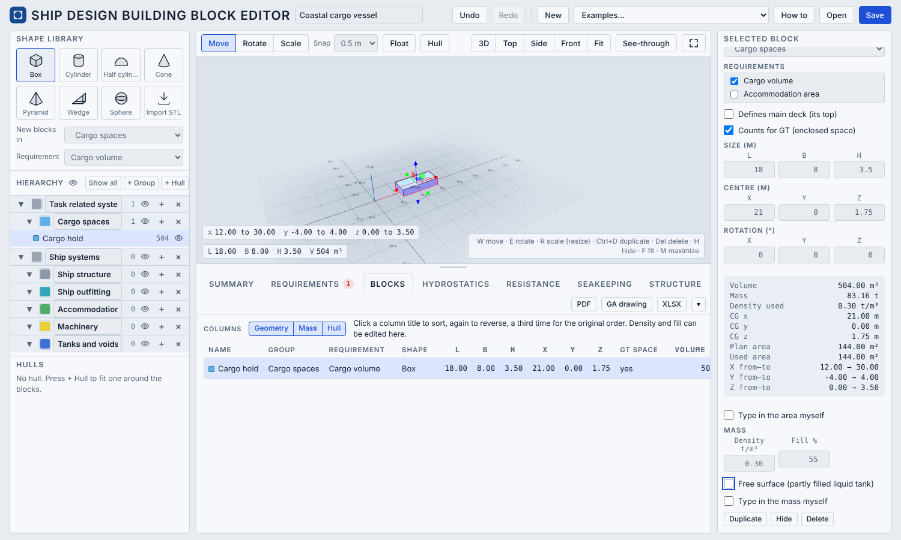

*Figure 3. The cargo hold selected, with the requirement linked.*

**What to observe.** The panel gives the volume (504 m³), the mass (the density of the group times the volume times the fill) and the centre of gravity. The *Requirements* tab shows the achieved cargo volume of 504 m³: the requirement is met at the shall, in the band between 400 and 600. The badge on the tab counts the requirements still not met.

### 3.3 The other four blocks

Add the following boxes in the same way, each in its group.

| Name | Group | Linked requirement | Size L × B × H, m | Centre X, Y, Z, m | Other |
|---|---|---|---|---|---|
| Machinery room | Machinery | none | 8 × 8 × 4 | 4, 0, 2 | tick *Defines main deck (its top)* |
| Fuel oil tanks | Tanks and voids | none | 4 × 8 × 4 | 10, 0, 2 | Fill 98% |
| Accommodation | Accommodation | Accommodation area | 10 × 8 × 3 | 25, 0, 5.5 | |
| Wheelhouse | Ship outfitting | none | 6 × 6 × 2.4 | 25, 0, 8.2 | |

The block that *defines the main deck* sets the depth of the hull later: the top of the machinery room, at 4 m. Press **Fit** to see all blocks.

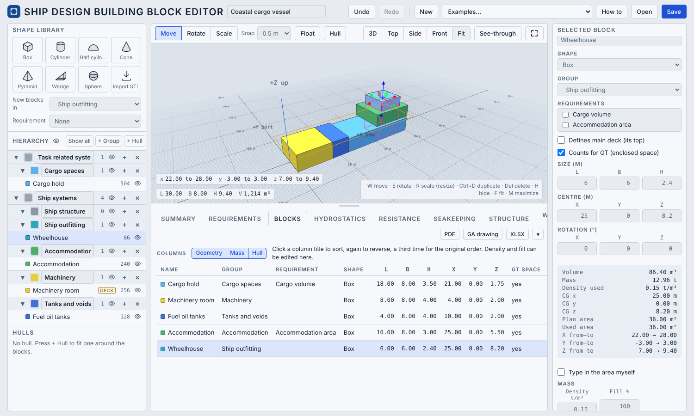

*Figure 4. The five blocks, with the Blocks tab listing them.*

**Moving and resizing by hand.** Select a block and choose **Move**: drag it, or drag its arrows. Choose **Scale** and drag one of the small cubes: the opposite face stays fixed. **Snap** rounds to a step. Undo is Ctrl+Z. Typed values are always exact.

### 3.4 Weight: densities

A block has no weight until it has a density. Densities are set per group, in the **Hydrostatics** tab, in the table *Weight by group*. Type:

| Group | Density, t/m³ |
|---|---|
| Cargo spaces | 0.6 |
| Ship outfitting | 0.15 |
| Accommodation | 0.12 |
| Machinery | 0.4 |
| Tanks and voids | 0.85 |

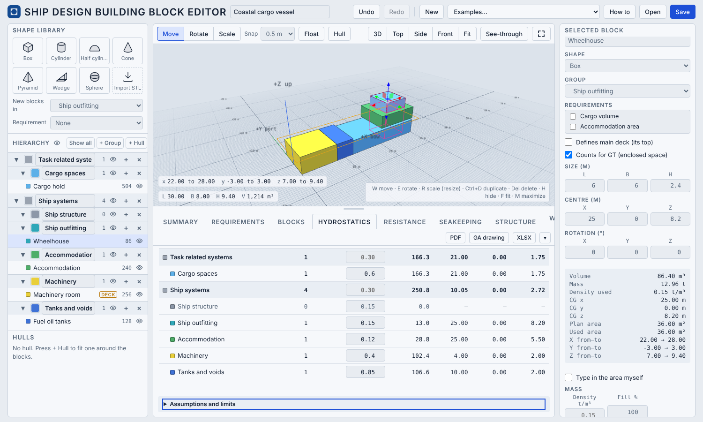

*Figure 5. Weight by group: blocks, density, mass and centre of gravity of each group.*

The density is an *average* over the whole space: a cargo hold with containers, an accommodation block with cabins and corridors. A single block can override the group density in its own panel. The mass of a block is the density times the volume times the fill. The block panel and the *Blocks* tab show it, and a mass can also be typed in directly, when the weight of an item is known.

**Structure.** The steel of the hull is not a block. It is added as a percentage of the displacement (25% by default), in the *Hydrostatics* tab. With the blocks at 417 t, the structure and outfitting share is 139 t, and the total is 556 t.

### 3.5 Read the Summary

Open the **Summary** tab. It lists the requirements met (3 of 3), the weight and the hull (not yet), and the geometry of the whole design: length 30.0 m, beam 8.0 m, height 9.4 m, gross volume 1,214 m³ and a gross tonnage estimate of 318.

**What to observe.** Three requirements are met at the shall: the cargo volume 504 m³ (in the band 400 to 600), the accommodation area 80 m² (70 to 100), and the length 30.0 m (the should).

**Exercises.**

1. Move the wheelhouse to the front of the accommodation block, to x = 27. Does any requirement change? Which value changes in the block panel?
2. Why does the cargo hold weigh 166 t, and not 504 t?
3. Increase the cargo fill to 100%. What happens to the total weight? (Restore 55% afterwards.)

---

## 4. The hull

### 4.1 Fit a hull

Press **+ Hull** in the hierarchy. The app fits a parametric hull around the blocks: its length, beam and depth come from the blocks, the depth being the top of the block that defines the main deck, and the draught is set from the weight. The new hull is called *Offshore vessel* and has a length of 31.55 m, a beam of 8.4 m, a depth of 4 m and a draught of 2.30 m.

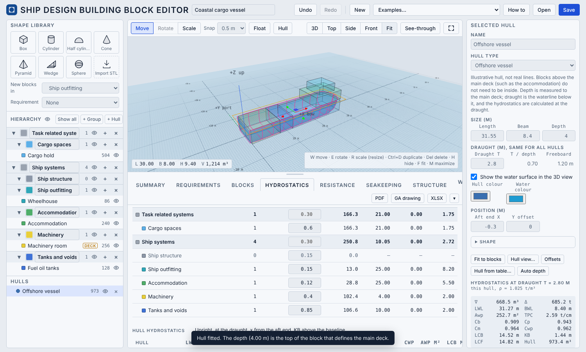

*Figure 6. The hull fitted around the blocks.*

The **Hull type** in the panel changes the family of shapes: *Offshore vessel*, *Research vessel*, *Cargo ship*, *Slender demihull* (for catamarans and trimarans), *Barge* or a hull from a table of offsets. The principal dimensions stay, and the coefficients change.

### 4.2 Blocks that are outside the hull

The hull is a smooth shape, and the blocks are boxes, so some corners stick out. Open the **Requirements** tab: the cargo volume is 504.0 m³ *achieved*, but the column *Inside hulls* gives 478.9 m³ (−25.1): that is the part of the hold that lies within the hull. The *Summary* says that 3.2% of the block volume below the main deck lies outside. A requirement is met by the blocks, but a requirement of cargo space is really met by the part that is *inside* the ship. This is a useful number when a hull is made fuller or finer.

### 4.3 The Hull view

Press **Hull** (beside **Float**). The Hull view opens full screen with the sheer plan, the half-breadth plan, the body plan and a 3D view.

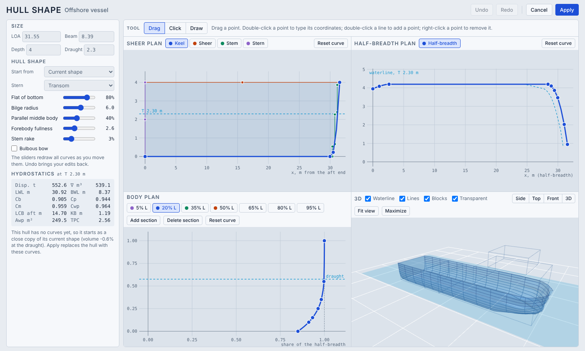

*Figure 7. The Hull view.*

- The sliders change the shape (*Flat of bottom*, *Bilge radius*, *Parallel middle body*, *Forebody fullness*, *Stem rake*) and redraw all curves.
- **Drag** moves a point of a curve, **Click** adds one and **Draw** draws a curve by hand.
- **Apply** replaces the hull, and **Cancel** leaves it as it was.

**What to observe.** The hydrostatics on the left update while the shape is changed: Cb 0.905, Cp 0.944, Cm 0.959 and a displacement of 553 t at the draught, for the shape as fitted. Move *Flat of bottom* from 80% to 0% (a V section): Cb falls to 0.563, Cm to 0.721, and the displacement at the same draught from 553 t to 339 t, so the ship would float deeper for the same weight. Press **Cancel** to return.

**Exercises.**

1. What is the depth of the hull, and which block sets it?
2. In the Hull view, set *Flat of bottom* to 0%. Which falls more in relative terms, Cb or Cm? (Cancel afterwards.)
3. Change the hull type to *Cargo ship* in the panel. What changes in the inside-hull volume of the cargo hold, and in Cb?

---

## 5. Floating and stability

### 5.1 Float

Press **Float** in the toolbar. The draught, trim and heel now follow the weight and the centre of gravity as blocks are moved. The panel in the 3D view shows the floating condition:

| Quantity | Value |
|---|---|
| Draught | 2.30 m |
| Trim | 0.01 m by the bow (0.02°) |
| Heel | 0° |
| GM | 1.55 m |
| KM / KG | 3.82 / 2.27 m |

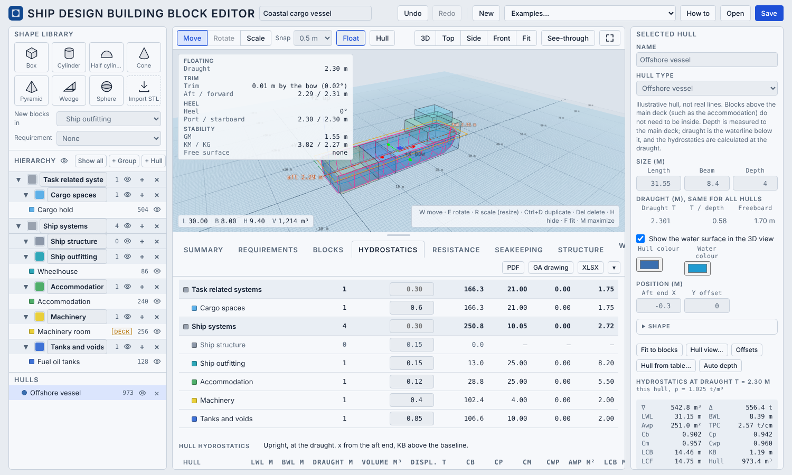

*Figure 8. Float on.*

The ship floats at the draught at which the weight (556 t) equals the buoyancy of the hull, with the centres of gravity and of buoyancy in the same vertical line: that fixes the trim. The weight and the displacement are in the *Hydrostatics* tab, under *Floating at the weight*.

### 5.2 Requirements, now with a hull

Open the **Requirements** tab again.

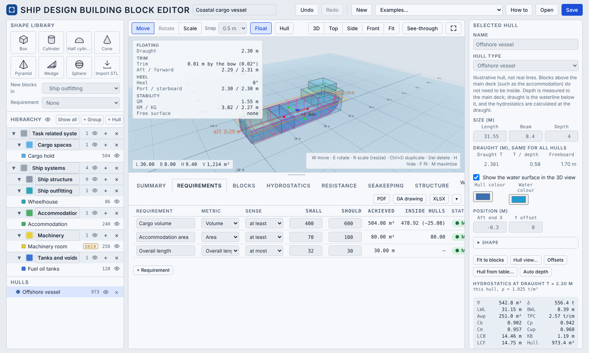

*Figure 9. The requirements with the ship floating.*

### 5.3 Initial stability

In the *Hydrostatics* tab, the table of the initial stability gives KB (1.19 m), BM (2.63 m), KM = KB + BM (3.82 m) and KG (2.27 m, the centre of gravity of the weights). GM = KM − KG = 1.55 m. The line *Highest KG for GM = 0.15 m* is 3.67 m: the margin in KG before the guide of 0.15 m is reached.

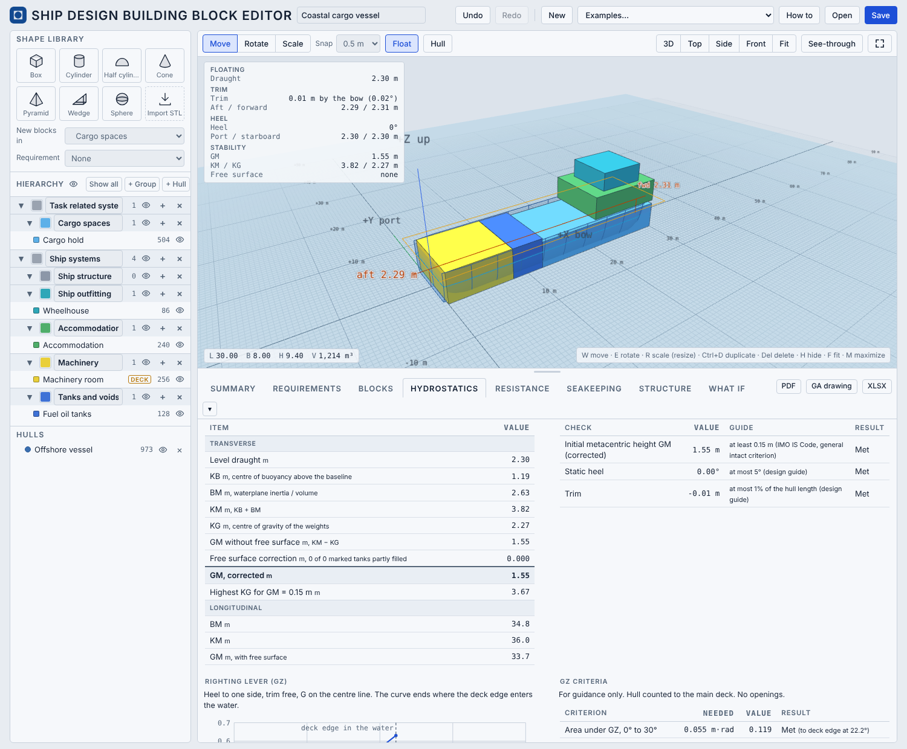

*Figure 10. Initial stability.*

### 5.4 The righting lever

The GZ curve plots the righting lever against the heel angle, from the real shape of the hull. For this ship the curve ends at 22.2°, where the deck edge enters the water, because buoyancy above the main deck is not modelled. The table of criteria gives: GM 1.55 m (met), the area under GZ to 30° (met, up to the deck edge), and three criteria that are not met because the deck edge is reached before 30° (Figure 11).

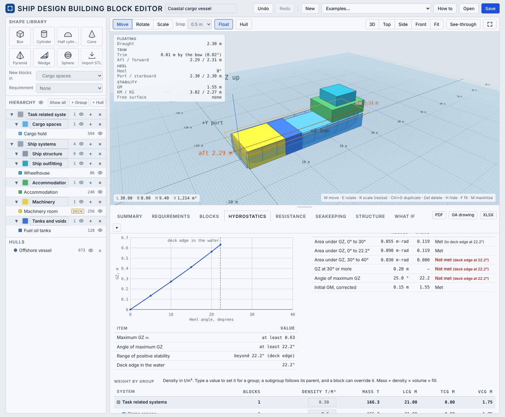

*Figure 11. The righting lever.*

**What to observe.** A boat with a low freeboard (1.7 m here) has a short range of stability, even with a good GM. A ship needs both.

**Exercises.**

1. What is the freeboard of the vessel? (Depth minus draught.)
2. Which hull property would increase the angle at which the deck edge enters the water?
3. Set the fill of the fuel oil tanks from 98% to 20%. What happens to the weight, the draught, the trim and GM?
4. Set the fill to 50% and tick *Free surface* in the block panel. What is the free surface correction, and the corrected GM?

---

## 6. The other tabs

These tabs use the hull and the weight already built. Each gives one estimate, with limits that the tab itself states.

### 6.1 Resistance

The *Resistance* tab draws the towing resistance of the hull against speed, by the Holtrop method, with the parts of it (frictional, form, wave, transom and correlation) at the chosen speed. The speed is typed under *Speed*, in knots.

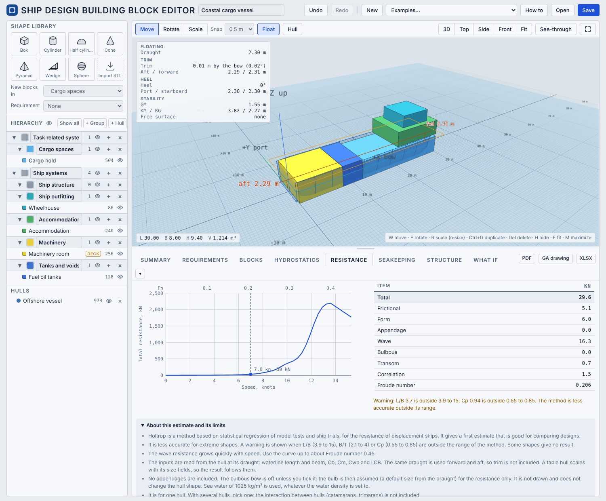

*Figure 12. The Resistance tab.*

| Speed, knots | Total resistance, kN | Of which wave, kN |
|---|---|---|
| 5 | 7.6 | 0.3 |
| 7 | 29.6 | 16.3 |
| 9 | 164.9 | 144.0 |
| 11 | 569.5 | 539.8 |

**What to observe.** From 5 to 7 knots the resistance rises almost four times, and from 7 to 11 knots nearly twenty times, because the wave-making part grows steeply once the Froude number (0.206 at 7 knots) passes 0.2. A short, full ship of 31 m has a practical speed limit well below 11 knots. The tab warns when the hull is outside the range of the method: this one is (L/B 3.7).

### 6.2 Seakeeping

The *Seakeeping* tab gives the motions of the hull in regular waves and in a sea state: heave, pitch, roll, the vertical motion and acceleration at a chosen position, and the limiting wave height for motion limits. It uses the weight, the GM and the hull of the design.

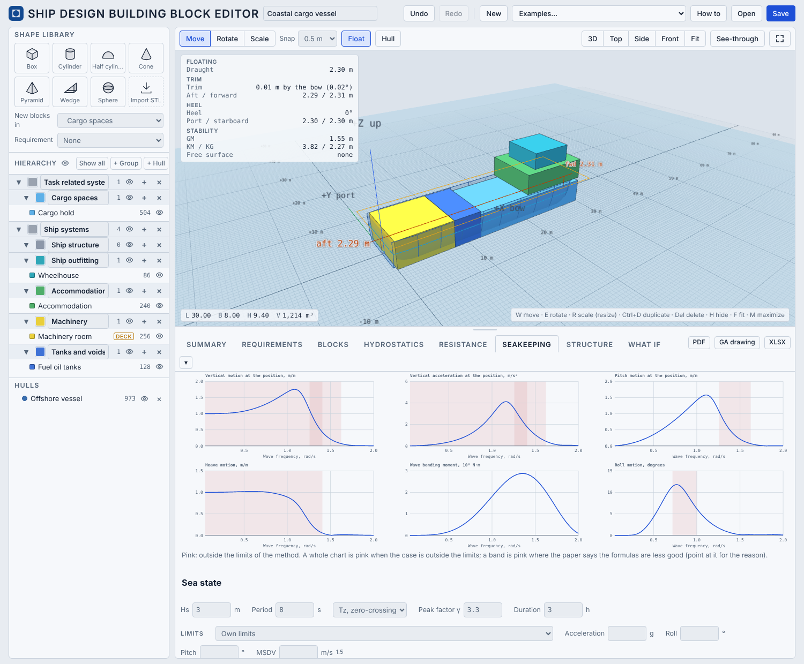

*Figure 13. The Seakeeping tab.*

For the default sea state (significant wave height 3 m, zero-crossing period 8 s, JONSWAP spectrum, 3 hours), the roll angle is 6.3° RMS and the significant heave is 1.5 m. The roll period is 5.7 s: a stiff ship, with a GM of 1.55 m, rolls fast. The text of the tab says which formulas are used and what is outside their range.

### 6.3 Structure

The *Structure* tab is a first check of the hull girder and the local scantlings to the DNV rules for ships under 100 m (2015). It reads the weight and the buoyancy at the floating position and gives the load, shear force and bending moment along the ship, the required section modulus, and, with a midship section typed in or sized to the rules, the local plate and stiffener sizes.

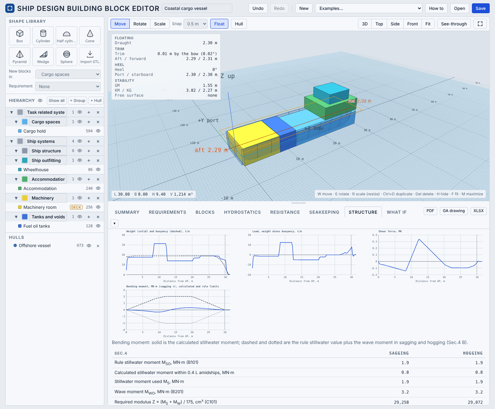

*Figure 14. The Structure tab.*

For the vessel, the stillwater moment used is 1.9 MN·m and the wave moment 3.2 MN·m. The minimum modulus is 86,156 cm³, so a midship section has to be built (a button gives a start) before the check means anything. The tab is for learning how the loads and the rules fit together, and it is not a class check.

**Exercises.**

1. At which speed in the table does the wave resistance first exceed the sum of all the other parts?
2. What happens to the roll period if the GM is reduced? (Seakeeping tab, with the GM typed.)
3. Which of the three tabs uses the weight, which the hull shape, and which both?

---

## 7. Playing with the design

The value of the model is in changing it and watching the result. Each experiment below starts from the finished design of chapter 5 with Float on. Undo (Ctrl+Z) restores it.

| # | Change | Where | Look at |
|---|---|---|---|
| 1 | Move the *Cargo hold* 2 m forward (x = 23) | block panel | trim, length |
| 2 | Cargo hold fill from 55% to 100% | block panel | weight, draught, trim, GZ |
| 3 | Hull depth from 4 m to 5 m | hull panel | GM, range of the GZ curve |
| 4 | Raise the *Wheelhouse* by 3 m (z = 11.2) | block panel | KG, GM |
| 5 | Fuel oil density from 0.85 to 0.2 | *Hydrostatics*, group density | weight, draught, trim |
| 6 | Machinery density from 0.4 to 1.5 | *Hydrostatics*, group density | the floating panel |

**Expected results** (from the finished design).

| # | Weight, t | Draught, m | Trim, m (+ stern) | GM, m | Range of GZ, ° | Note |
|---|---|---|---|---|---|---|
| Start | 556 | 2.30 | −0.01 | 1.55 | 22.2 | |
| 1 | 556 | 2.30 | −0.57 | 1.55 | 19.6 | length now 32.0 m, the shall |
| 2 | 692 | 2.83 | −1.39 | 1.43 | 8.1 | freeboard falls to 1.17 m |
| 3 | 554 | 2.32 | −0.07 | 1.39 | 33.4 | GM falls, the range grows |
| 4 | 556 | 2.30 | −0.01 | 1.48 | 22.2 | KG rises by 0.07 m |
| 5 | 475 | 1.98 | −0.67 | 1.75 | 23.1 | lighter, trims by the bow |
| 6 | not floating | | | | | *Overloaded* message |

**What to observe.**

- **1.** A weight moved forward trims the ship by the bow. The length of the ship becomes 32.0 m, on the limit of the shall.
- **2.** A full hold is the real loaded condition. The draught grows by half a metre and the freeboard shrinks to 1.17 m: GM stays good but the range of stability collapses. A requirement of "cargo volume" is not enough to make a safe design; the *weight* of the cargo must be seen.
- **3.** A deeper hull *lowers* GM a little (the weight is higher), and *extends* the range of stability a lot, since the deck edge goes under water later.
- **4.** Weight high up costs GM at no gain.
- **5.** A lighter ship floats higher and trims where the weights are least balanced.
- **6.** When the weight is more than the hull displaces at full depth, the panel says *Overloaded* and the floating results are not shown. Restore the density with Undo.

**Exercise.** Find a way to carry the full hold (fill 100%) and still keep a range of stability of at least 30°. Hint: experiment 3. Write down the depth of the hull and the resulting weight, draught and GM.

---

## 8. What if: the right ship for the right mission

A design that meets the shall is only the beginning. The question after it is: *how would the ship change if the requirement were more or less demanding?* The *What if* tab answers it for one requirement at a time. It is a simplified form of the idea of testing a design against changing needs and contexts in epoch-era analysis (Ross and Rhodes, 2008). The mission is the set of operational profiles that the ship is used for, each profile a set of states, each state with performances that the ship must provide (Gaspar et al., 2015). The requirements of the app stand for the performances of the mission, and *What if* asks how the ship would have to be for a more or less demanding value of one of them.

### 8.1 Open the window

Click the tab **What if**. A window opens, as the Hull view does (Figure 15).

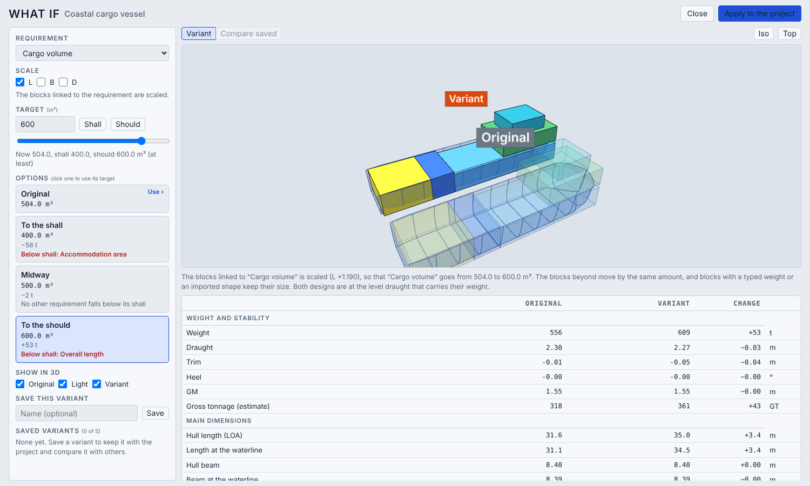

*Figure 15. The What if window for the cargo volume.*

1. **Requirement.** *Cargo volume* is chosen.
2. **Scale.** The directions to scale are ticked: L (length), B (beam), D (depth). With L only, the cargo hold is lengthened or shortened.
3. **Target.** Four options are ready: *Original* (504 m³), *To the shall* (400 m³), *Midway* (500 m³) and *To the should* (600 m³). Click one to use its target, or type a value or drag the slider.

The blocks linked to the requirement are scaled in the ticked directions, the blocks beyond them are moved by the same amount, blocks that span the stretch are stretched with it, and the hull follows. The result is floated at its own level draught. The original is drawn light beside the variant.

### 8.2 Save and compare

Press **Save** to keep the variant, with an optional name. Up to five variants are kept in the project. The tab **Compare saved** shows the original and all saved variants in one 3D view, one table and one set of plots. In the table, every line of weight, stability, dimensions, coefficients and requirements has a column for each design.

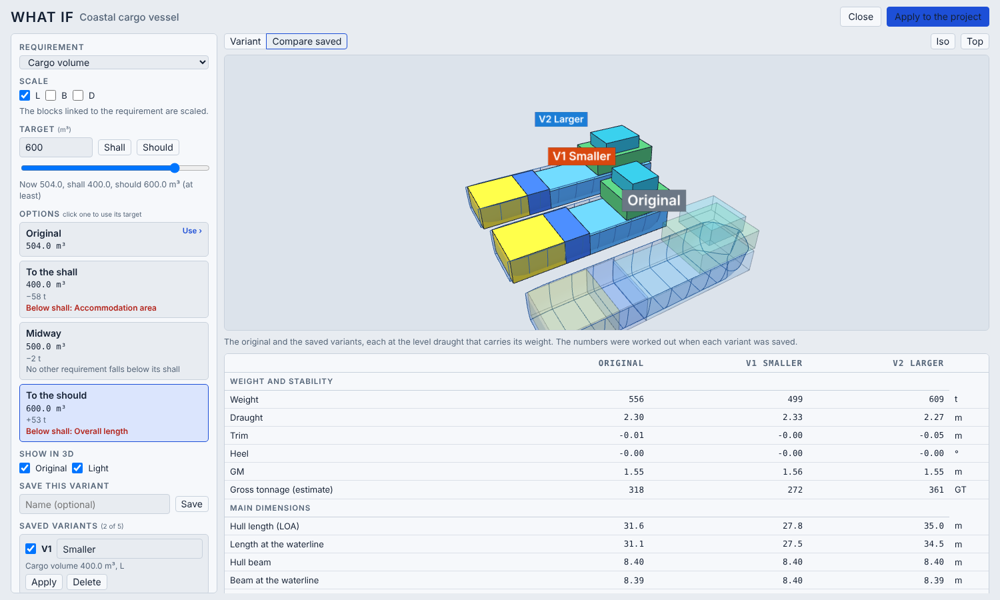

*Figure 16. Comparing the original and two saved variants.*

For the cargo volume, the results are:

| Design | Cargo volume, m³ | Weight, t | Hull length, m | GM, m | Not met |
|---|---|---|---|---|---|
| Original | 504 | 556 | 31.6 | 1.55 | none |
| To the shall | 400 | 499 | 27.8 | 1.56 | Accommodation area |
| To the should | 600 | 609 | 35.0 | 1.55 | Overall length (33.4 m) |

**What to observe.**

- The ship for the shall is 57 t lighter and 3.8 m shorter, but the accommodation sits on top of the hold, so it shortens with it, and its area falls from 80 m² to 63.5 m², below the shall of 70 m². *One requirement served can break another.*
- The ship for the should is 53 t heavier and 3.4 m longer in the hull, and it breaks the length requirement: the overall length of the design is 33.4 m against a shall of 32 m.
- Neither extreme is "the" answer. The comparison shows what each level of the requirement costs, which is what a requirement is for.

### 8.3 Use a variant

**Apply** replaces the project by a variant (Undo brings back the previous one). The saved variants are stored in the project file, and are in the PDF report and in the Excel file.

**Exercises.**

1. Scale the *Accommodation area* to the should (100 m²) with L only. What happens to the length of the ship, and does the cargo volume change?
2. Scale the *Cargo volume* to the should with L and B ticked. How does the length compare with L only? Save both and compare them.
3. Explain in two sentences why the ship that meets the *should* of the cargo volume is not necessarily the better ship.

---

## 9. Outputs

| Button | Result |
|---|---|
| **Save** | A JSON file with the whole project, including the saved variants. **Open** loads it again. |
| **PDF** | A design report: views, requirements, systems, weights, hydrostatics, stability, resistance, seakeeping, structure, the *What if* variants (or the options of the tab, when none is saved) and the general arrangement sheets. |
| **XLSX** | The project as an Excel workbook, with a sheet for each tab and a *Variants* sheet when variants are saved. The masses and totals are formulas. |
| **GA drawing** | The general arrangement as A3 sheets, as DXF (full size, millimetres) or PDF. |

Every file name carries the date and time. Generate the PDF at the end of the final exercise.

---

## 10. Evacuation

The blocks of the design can also be walked through. Give a block a role (room, corridor, stair, muster station), and the editor draws the floors, walls, doors and stairs, checks that every room has a way out, and runs a walking simulation of the persons going to the muster station. The method and its limits are in section 3.8 and 3.9 of the *Manual*; here the vessel is used to see what it gives.

### 10.1 The design with a deck arrangement

Press **Open** and load `coastal-cargo-vessel-evac.json`. It is the finished design of chapter 5 with five blocks added: the walking spaces of the main deck and the bridge deck. The weights and the stability do not change (GM 1.55 m): the five blocks have a mass of 0 t and do not count for the gross tonnage. Only the gross volume grows, to 1,463 m³, because the walking spaces are blocks too.

| Name | Group | Size L × B × H, m | Centre X, Y, Z, m | Role |
|---|---|---|---|---|
| Muster station | Ship outfitting | 4 × 8 × 2.4 | 2, 0, 5.2 | Muster station |
| Open deck aft | Ship outfitting | 4 × 8 × 2.4 | 6, 0, 5.2 | Open deck |
| Corridor | Ship outfitting | 12 × 2.4 × 2.4 | 14, 0, 5.2 | Corridor |
| Stair to bridge deck | Ship outfitting | 4 × 1.2 × 3 | 18, −0.6, 5.5 | Stair, up *+x* |
| Bridge deck walkway | Ship outfitting | 2 × 2.4 × 2.4 | 21, 0, 8.2 | Corridor |

The accommodation block is a *Room* (space *Cabin*, 6 berths, 6 persons) and the wheelhouse a *Room* (space *Work or service space*, capacity 3, 2 persons). The machinery room, the tanks and the cargo hold have no role: they lie below the main deck. To build the same arrangement on the design of chapter 5, add the five boxes of the table (tick *Type in the mass myself* with 0 t, and untick *Counts for GT*) and set the roles in the **Evacuation** section of the right panel.

### 10.2 Roles and doors

Select the *Accommodation* block and scroll the right panel to the **Evacuation** section.

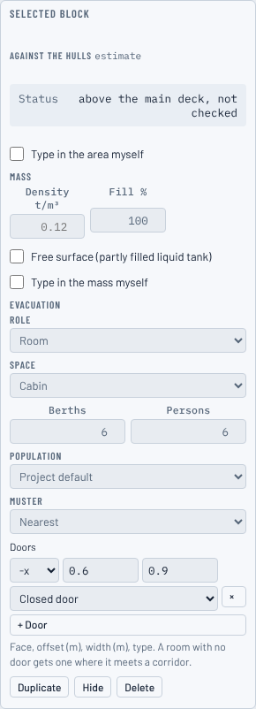

*Figure 17. The roles of a block: role, space, berths, persons and doors.*

The door is on the face *−x* (towards the stern), 0.6 m from the middle of the face and 0.9 m wide, and it opens on the corridor. The wheelhouse has a door on its *−x* face, which opens on the bridge deck walkway, and a stair joins the walkway to the corridor.

### 10.3 The walkable view

Press **Walkable** above the 3D view, then **3D** and **Fit**.

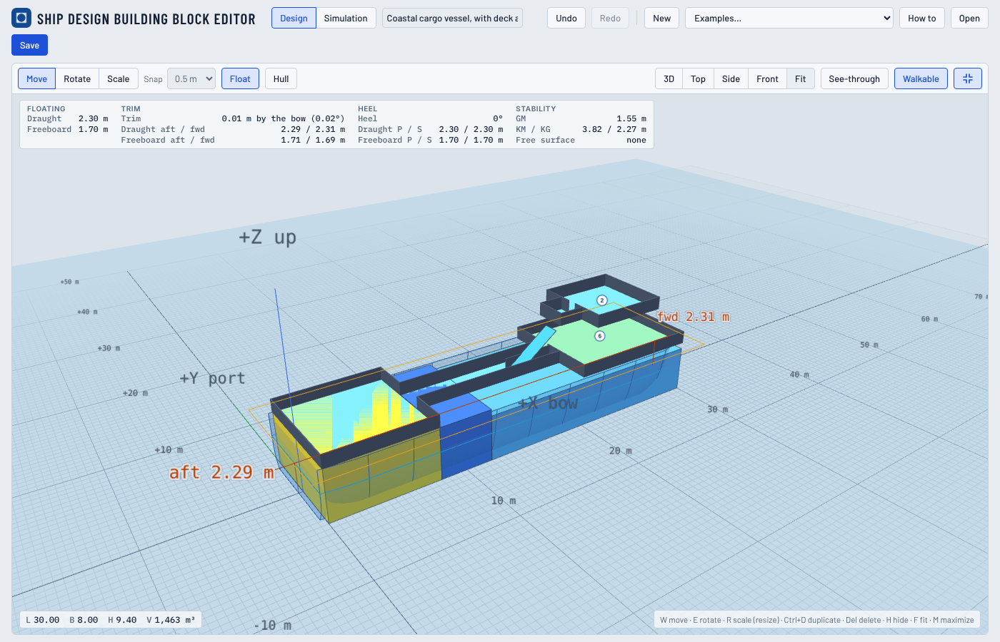

*Figure 18. The walkable view. The persons of each space are shown as a number, 6 in the cabin and 2 in the wheelhouse.*

**What to observe.** The Summary tab has no warning about the arrangement: every room has a way to the muster station. The walls are drawn on the edges of each floor, the door gaps are open, and the stair leads from the corridor up to the bridge deck. The machinery room, the tanks and the hold have no role and stay solid blocks.

### 10.4 The Simulation: night and day

Press **Simulation** in the top bar. The panel on the left holds the scenario. Choose *Occupancy* **Night (IMO case 1)**, and **Calculation speed** with the speed slider, then press **Run**.

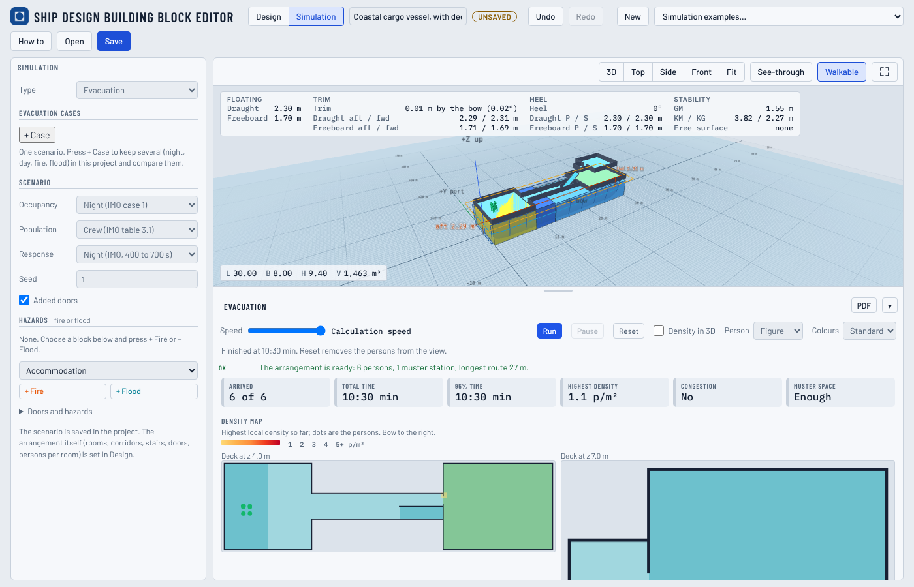

*Figure 19. The night case: the persons start 400 to 700 s after the alarm, as in the IMO guidelines.*

**What to observe.** The persons are the 6 berths of the cabin. All 6 arrive, the total time is 10 min 30 s (630 s) and the highest density is 1.1 persons per m². Almost all of the time is the response: the walk itself takes about 30 s. The case *As set in the blocks* (no response time) gives 8 persons (6 in the cabin and 2 in the wheelhouse) arriving after 31 s.

Now press **+ Case** (it copies the settings), choose *Occupancy* **Day (IMO case 2)**, and **Run**. In the day case the cabins are filled to 50% (3 persons) and the wheelhouse to its capacity (3 persons). The response is shorter (0 to 300 s): all 6 arrive after 2 min 36 s (156 s).

### 10.5 A fire

Press **+ Case** again. In the *Hazards* list choose the block *Accommodation* and press **+ Fire**. The fire starts at 0 s and spreads at 0.15 m/s from the block through its door. Press **Run**.

**What to observe.** 3 of 6 persons arrive, and 3 are caught. The last arrival at the muster station is at 58 s. The 3 persons that were in the accommodation, where the fire starts, cannot leave. The 3 persons of the wheelhouse walk down the stair and out through the corridor before the fire reaches it.

### 10.6 Cases side by side

Give each case a name in the box under the list (*Night*, *Day*, *Day, fire in the accommodation*). When there are two or more cases, a table compares them, and a click on a row opens the case.

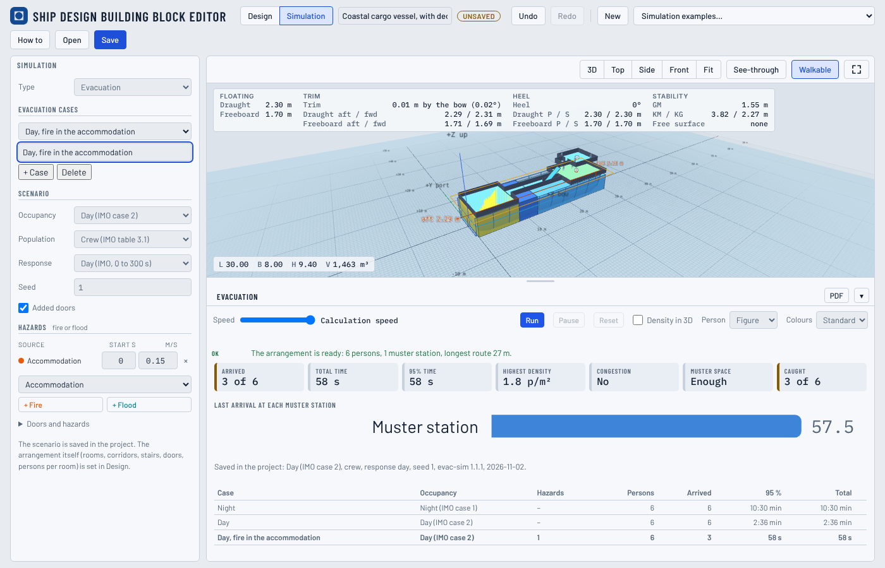

*Figure 20. The cases of the vessel: night, day and day with a fire.*

The cases are saved in the project file with their results (**Save**), and the PDF has a table with all of them.

**Exercises.**

1. Delete the door of the accommodation block (the **×** button beside it). Run the *As set in the blocks* case. What changes in the walkable view and in the time?
2. Put a fire in the *Corridor* at 20 s, in the day case. How many persons are caught? What does it tell you about the arrangement?
3. Run the night case with seed 2 and seed 3, and compare it with seed 1 (630 s). Why do the times differ?
4. In the case *As set in the blocks*, change *Population* from **Crew** to **Passengers**. What happens to the time, and why?
5. Set the berths and the persons of the accommodation to 30 (*As set in the blocks*). How do the total time and the highest density change?

---

## 11. Final exercise

Design a second ship from the empty project, with the following requirements, and write a half-page note on the result.

| Requirement | Metric | Sense | Shall | Should |
|---|---|---|---|---|
| Deck area for cargo | Area | at least | 120 m² | 160 m² |
| Accommodation area | Area | at least | 50 m² | 70 m² |
| Total weight | Total weight (with structure) | at most | 900 t | 800 t |
| Overall length | Overall length (X) | at most | 45 m | 40 m |

**Tasks.**

1. Build the blocks (a cargo deck, accommodation, wheelhouse, machinery, tanks, a crane or a winch of own choice) and set their groups and densities.
2. Fit a hull, set *Float* and bring the trim within 1% of the length and the GM above 0.15 m.
3. Check the three tabs of chapter 6 and note one result in each.
4. Use *What if* on the deck area: save the shall and the should as variants.
5. Make the PDF and write the note: which requirements are met and with which margin, what the *What if* variants show, and one decision about the design that the checks support.

---

## 12. Answers to the exercises

**Chapter 2.** (1) More cargo is better, so a minimum; a longer ship is a problem in ports and berths, so a maximum. (2) The status of the cargo volume stays red or orange: with the shall at 800 m³ the design (504 m³) does not meet it. Restore 400 and the status is green.

**Chapter 3.** (1) The accommodation area does not change, nor the length (the wheelhouse stays inside the length of the accommodation); the centre of gravity of the weights changes slightly in x. (2) 504 m³ × 0.6 t/m³ × 0.55 = 166 t: the density is that of the group and the fill is 55%. (3) The weight rises by 136 t (from 556 to 692 t, structure share included).

**Chapter 4.** (1) 4 m, set by the machinery room, the block that defines the main deck. (2) Cb: it falls from 0.905 to 0.563 (−38%), Cm from 0.959 to 0.721 (−25%). (3) The part of the cargo hold inside the hull grows from 478.9 m³ to 484.5 m³, and Cb from 0.902 to 0.910: the cargo-ship family is a little fuller.

**Chapter 5.** (1) 4.00 − 2.30 = 1.70 m. (2) A larger depth (a higher deck edge) or a smaller draught; the beam also changes the angle. (3) The weight falls from 556 t to 471 t, the draught from 2.30 m to 1.97 m, the ship trims 0.69 m by the bow (the weight that left was aft), and GM rises from 1.55 m to 1.77 m. (4) The correction is 0.29 m, and the corrected GM is 1.38 m.

**Chapter 6.** (1) At 7 knots: the wave resistance is 16.3 kN and the other parts together 13.3 kN (5.1 + 6.0 + 0.7 + 1.5). At 5 knots the wave part is only 0.3 kN of 7.6 kN. (2) The roll period grows, because the period varies with 1/√GM. (3) The structure tab uses the weight (and the buoyancy), the resistance tab only the hull and the draught, and the seakeeping tab both (the hull and the GM from the weight).

**Chapter 7.** With the full hold, a hull depth of 5 m gives a range of 20.2°, 5.5 m gives 25.8° and 6 m gives 31° (GM 1.21 m, draught 2.88 m, weight 688 t). There are other solutions, such as a wider hull or lower weights, and each costs something elsewhere.

**Chapter 8.** (1) The weight rises to 601 t and the hull to 34.0 m, and the overall length becomes 32.5 m, which is beyond the shall of 32 m. The cargo volume grows to 574 m³, because the accommodation lies over the hold and the stretch includes the hold. (2) With L and B the hull is 33.2 m long (35.0 m with L only), the beam grows from 8.40 m to 9.13 m, the weight is 635 t (609 t with L only) and GM is 2.02 m. The overall length of the design is 31.6 m, so the length requirement is met, which it is not with L only (33.4 m). (3) Because the extra cargo volume is paid for by 53 t of weight, 3.4 m of length (beyond the shall of the length requirement) and the cost of the larger ship. The better ship is the one whose cost, risk and fit with the other requirements the owner prefers.

**Chapter 10.** (1) The door in the walkable view turns amber: the rules add a door of 0.9 m where the room meets the corridor, and the time is the same (31 s). A room with no door is a warning only when it has no corridor beside it. (2) All 6 persons are caught: the corridor is the only way to the muster station, so a fire in it cuts everyone off. A ship needs a second, independent route. (3) The seed sets the response time of each person: the total time is 707 s with seed 2 and 600 s with seed 3. One run is one sample; use several seeds before drawing a conclusion. (4) The time grows from 31 s to 52 s, because the passenger group walks more slowly: the IMO groups have different walking speeds. (5) The total time rises to 70 s and the highest density to 4.4 persons per m², above the congestion line of 4 persons per m²: the 32 persons queue at the door of 0.9 m.

---

## References

- Gaspar, H.M., Brett, P.O., Erikstad, S.O. and Ross, A.M. (2015). Quantifying value robustness of OSV designs taking into consideration medium to long term stakeholders' expectations. 12th International Marine Design Conference (IMDC 2015), Tokyo.
- Ross, A.M. and Rhodes, D.H. (2008). Using natural value-centric time scales for conceptualizing system timelines through epoch-era analysis. INCOSE International Symposium 2008, Utrecht.
- Gaspar, H.M., Fonseca, Í.A. and Andrews, D. (2024). Wither now the Design Building Block (DBB) Approach. International Marine Design Conference (IMDC 2024). https://doi.org/10.59490/imdc.2024.915
- Gaspar, H.M. (2026). *Ship Design Building Block Editor: Manual*. NTNU. https://shiplab.github.io/dbb/
