# Ship Design Building Block Editor: Manual

**Version 1.2.0 · October 2026**
Henrique M. Gaspar, NTNU · https://shiplab.github.io/dbb/

> **Educational use only.** This tool is made for teaching and for early concept exploration. The hulls are illustrative, not real lines, and the weights, hydrostatics, stability and resistance are simplified estimates. The results must not be used for design approval, class or flag-state documentation, or any safety-critical decision. The software is provided as it is, without warranty.

**How to cite.** Gaspar, H.M. (2026). *Ship Design Building Block Editor* [Computer software]. NTNU. https://shiplab.github.io/dbb/

**Contents**

1. Introduction
2. Quick start
3. The model
4. Theory and method
5. The Hull view
6. Outputs
7. Assumptions and limitations
8. Reference: glossary, shortcuts, file formats

Appendix A. Holtrop formulas

Appendix B. Table of offsets as input and output

Appendix C. The project file (JSON)

Appendix D. Seakeeping formulas as used in the app

Appendix E. Structure formulas as used in the app


---

## 1. Introduction

### 1.1 What this is

The Ship Design Building Block Editor is a web app for teaching early-stage ship design. Spaces and systems are modelled as blocks in 3D. The app sums volume, area, weight and centres of gravity by system, checks them against requirements, floats the design on an illustrative hull, and gives hydrostatics, stability, gross tonnage and a resistance estimate. A hull view reshapes the hull with curves. It runs in the browser with no installation.

### 1.2 Ideas behind it

The app began as an implementation of the Design Building Block (DBB) approach from University College London (Pawling and Andrews, 2008; Andrews, 2011; *Wither now the Design Building Block (DBB) Approach*, Gaspar, Fonseca and Andrews, IMDC 2024). It has since grown beyond it and is no longer a pure DBB tool. It also draws on system-based ship design (Levander, 2012), which groups the ship by systems and not only by spaces. It builds on a 2D block layout prototype from 2015, later published as a way to quantify interfaces in general arrangement drawings (Gaspar and Andrews, IMDC 2022).

### 1.3 Web-based tools from the lab

The Ship Design and Operations Lab at NTNU in Ålesund has published ship design and engineering tools as web apps since 2013. The first was a simple parametric design written in HTML and JavaScript. Most of the tools were made by the author with students.

The reason for the web is practical. A model that several people must use, share and develop is easier to handle in a browser than as a spreadsheet, a Matlab script or a set of slides, because nothing has to be installed and there are no version or licence problems. This argument is made in *JavaScript Applied to Maritime Design and Engineering* (Gaspar, COMPIT 2017), which also noted that JavaScript was still rare in ship design. It called for open, shared code. The open Vessel.js library for conceptual ship design followed (IMDC 2018, updated at IMDC 2022).

The lab's view of open and collaborative ship design, and the use of open web tools in teaching, is in Gaspar (COMPIT 2022). This app follows that line: the code is open and the project file is a documented JSON file (Appendix C).

### 1.4 Then and now

In 2017 the argument for web apps in ship design had to be made. In 2026 AI writes web apps routinely, and the barrier is no longer writing the code but deciding what a tool should do and trusting what it says. This app and manual are a case of that. It was developed by Henrique Gaspar in dialogue with Claude (Anthropic). Claude wrote and tested the code, and the author set the scope, decided the content and checked the results. It reuses much from the lab: the DBB approach, a web implementation of the Holtrop resistance method, the general-arrangement block idea and the R/V Gunnerus data.

### 1.5 Credits

The app reuses ideas, methods and code from several people, and the list below is not exhaustive. The credits are given here in more detail than in the app.

- **Block layout.** The 2D block layout prototype of 2015 is by Henrique Gaspar.
- **Design Building Block approach.** David Andrews, Rachel Pawling and Alexander Piperakis, University College London (UCL).
- **System-based ship design.** Kai Levander and Stein Ove Erikstad, NTNU (Levander, 2012; Erikstad and Levander, 2012). The anchor handling tug supply (AHTS) example is based on the offshore vessel studies of this approach (Levander, 2012).
- **Resistance.** The code of the ShipLab Holtrop web app is by Jefferson Flor (NTNU and the Federal University of Santa Catarina, UFSC), with insights from Christopher Ryan (UCL). The method is that of Holtrop and Mennen (1982) and Holtrop (1984).
- **Ship motion.** The code of the ShipLab ship motion web app is by Sthefano Lande Andrade (NTNU), developed with the author in 2015 and updated by Gaël Porée and Maxime Albouy (SeaTech, Toulon) during an internship. The method is that of Jensen, Mansour and Olsen (2004).
- **Ship structure.** The ship structure web app of the ShipLab (2015, version 0.2) is by Sthefano Lande Andrade (NTNU). The structure tab takes its idea of a first check from the weight and buoyancy distribution and the hull girder moments of that app, and applies the rules of DNV (Rules for Ships, Pt.3 Ch.2, Hull structural design, ships with length less than 100 metres, January 2015).
- **Vessel.js library.** Felipe Ferrari, Ícaro Fonseca, Olivia Chaves, Thiago Monteiro and Elias Hasle (all NTNU). The formulation of the app also draws on it.
- **Motion sickness.** The weighting filter, the dose value and the limit values follow the doctoral research on motion sickness of seafarers by Nicole Catherine Taylor and Anriëtte Bekker, Stellenbosch University (Taylor, 2023).

The approach and the app also owe much to the many colleagues, students and collaborators at NTNU, UCL and other institutions, whose discussions, testing and feedback over the years shaped them, and who cannot all be listed here.

### 1.6 What it is and is not

A tool for teaching and early concept exploration. It is not for design approval, class or safety decisions (see section 7).

---

**References for chapter 1**

- Andrews, D.J. (2011). Marine Requirements Elucidation and the Nature of Preliminary Ship Design. *The International Journal of Maritime Engineering*, 153(1), A23–A39.
- Gaspar, H.M. (2017). JavaScript Applied to Maritime Design and Engineering. 16th International Conference on Computer and IT Applications in the Maritime Industries (COMPIT'17), pp. 428–443.
- Gaspar, H.M. (2018). Vessel.js: An open and collaborative ship design object-oriented library. In *Marine Design XIII*, Vol. 1, Proceedings of the 13th International Marine Design Conference (IMDC 2018), Helsinki. CRC Press.
- Gaspar, H.M. (2022). Open and Collaborative Ship Design. 21st International Conference on Computer and IT Applications in the Maritime Industries (COMPIT'22), pp. 416–428.
- Gaspar, H.M. (2022). Current State of the Vessel.js Library: A Web-based Toolbox for Maritime Simulations. 14th International Marine Design Conference (IMDC 2022), Vancouver. SNAME. https://doi.org/10.5957/IMDC-2022-271
- Gaspar, H.M. and Andrews, D. (2022). Quantifying Interfaces in General Arrangement Drawings. 14th International Marine Design Conference (IMDC 2022), Vancouver. SNAME. https://doi.org/10.5957/IMDC-2022-269
- Gaspar, H.M., Fonseca, Í.A. and Andrews, D. (2024). Wither now the Design Building Block (DBB) Approach. International Marine Design Conference (IMDC 2024). https://doi.org/10.59490/imdc.2024.915
- Erikstad, S.O. and Levander, K. (2012). System based design of offshore support vessels. 11th International Marine Design Conference (IMDC 2012), Glasgow.
- Holtrop, J. (1984). A statistical re-analysis of resistance and propulsion data. *International Shipbuilding Progress*, 31(363), 272–276.
- Holtrop, J. and Mennen, G.G.J. (1982). An approximate power prediction method. *International Shipbuilding Progress*, 29(335), 166–170.
- Jensen, J.J., Mansour, A.E. and Olsen, A.S. (2004). Estimation of ship motions using closed-form expressions. *Ocean Engineering*, 31, 61–85.
- Levander, K. (2012). System-Based Ship Design (SBSD). NTNU.
- Pawling, R.J. and Andrews, D.J. (2008). Concept studies for a joint support ship. *Journal of Naval Engineering*.
- Taylor, N.C. (2023). *A human cyber-physical system implementation for seafarers*. Doctoral dissertation, Stellenbosch University.

---

## 2. Quick start

This chapter walks through one design from start to finish. It uses the example the page opens on, a feeder container ship, so there is nothing to build first. Every step is described in more detail in chapter 3 and later.

**Before starting.** Open https://shiplab.github.io/dbb/ in a current browser (Chrome, Edge, Firefox or Safari). The 3D view needs WebGL. Nothing is stored in the browser: use **Save** to keep the work.

### 2.1 Look at the design

1. The 3D view shows the blocks of the container ship. Drag the background to orbit, right-drag to pan and use the wheel to zoom. The buttons **3D**, **Top**, **Side**, **Front** and **Fit** give standard views. **Maximize** (the corner-brackets button, or M) gives the 3D view the whole window, and **Restore** or Esc goes back.
2. The hierarchy on the left lists the blocks by group. Click a row to select the block, and the panel on the right shows its name, shape, group, size, position and density.
3. The **Summary** tab under the 3D view is the assessment of the design. It shows the main results and lists problems and notes. Each item links to the tab or the block to look at.

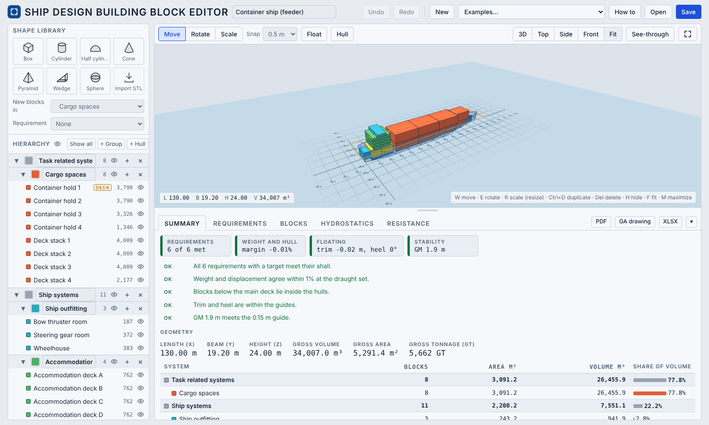

*Figure 1. The window on opening: shape library and hierarchy on the left, the 3D view and its toolbar, the tabs and tables below, and the panel of the selected block on the right.*

### 2.2 Change something

1. Select a block and choose **Scale**. Drag one of the small coloured cubes: the opposite face stays fixed, so the block grows from one side. Exact values can also be typed in the right panel.
2. Choose **Move** and drag the block, or type its position. **Snap** aligns block faces to the chosen step.
3. Watch the Summary: volumes, areas, weight and the status of each requirement update at once. Undo is Ctrl+Z.

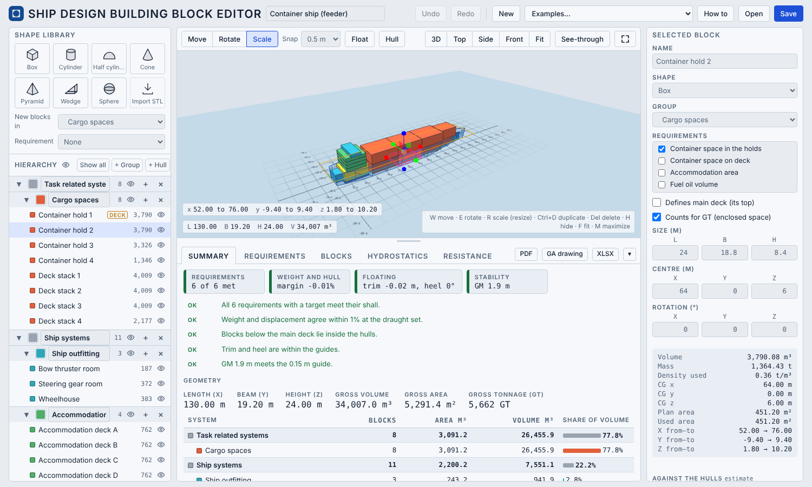

*Figure 2. A block selected with Scale. The small coloured cubes resize it, and the panel on the right shows its size, centre, volume, mass and centre of gravity.*

### 2.3 Check the requirements

Open the **Requirements** tab. Each requirement has a metric, a direction (at least or at most) and two targets, *shall* and *should*. Red means the shall is not met. Green is between shall and should. Orange means more than the should (an excess). The margin is shown beside each.

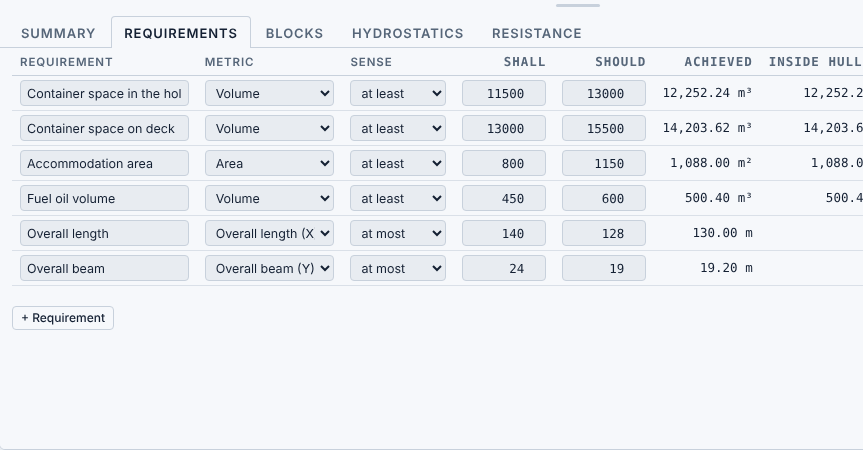

*Figure 3. The Requirements tab of the container ship: metric, direction, shall and should targets, and the achieved value.*

### 2.4 Float it and check the hull

1. Press **Float** in the toolbar. The draught, trim and heel now follow the weight as blocks are moved.
2. Open the **Hydrostatics** tab. It shows the floating condition, the weight balance (weight against displacement), the initial stability (KB, BM, KM and GM) and the righting lever (GZ).
3. Open the **Resistance** tab. It draws the total resistance against speed by the Holtrop method, with the parts at the service speed.
4. Open the **Seakeeping** tab. It gives the ship motions in regular waves, and then in a sea state, with significant and maximum values and the limiting wave height for chosen motion limits.
5. To change the shape of the hull, press **Hull** (beside Float). The Hull view opens full screen. Move a shape slider or drag a point on a curve, and press **Apply** to replace the hull or **Cancel** to leave it as it was.

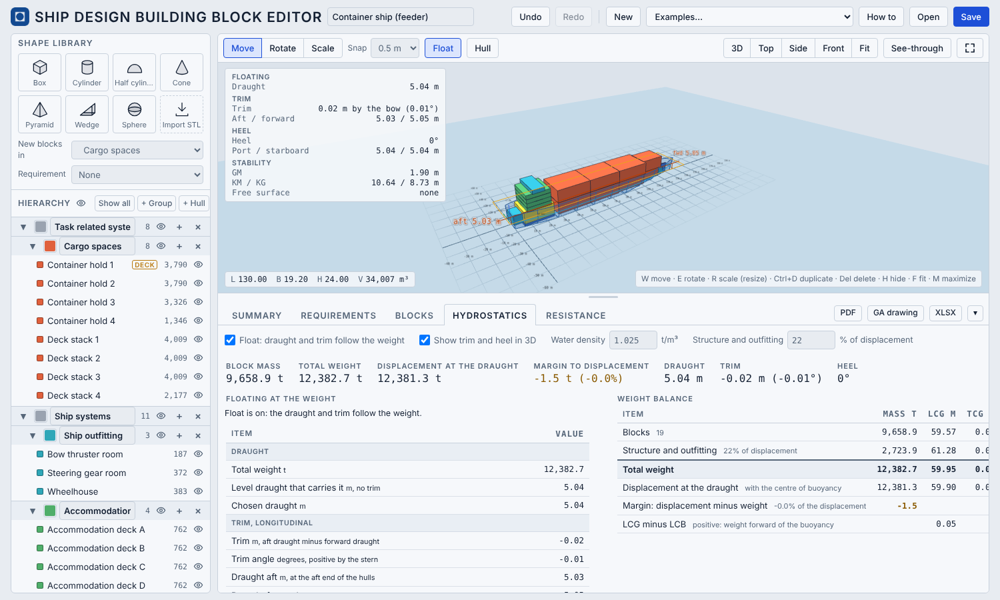

*Figure 4. Float on. The 3D view shows the draught, trim, heel and stability figures, and the Hydrostatics tab lists the weight balance, the initial stability and the righting lever.*

### 2.5 Save and export

- **Save** writes a JSON file that can be opened again later.
- **XLSX** writes the whole project as an Excel workbook.
- **PDF** writes a report, with the general arrangement sheets at the end.
- **GA drawing** writes the general arrangement as DXF or PDF.

Every file name carries the date and time, so a new save does not replace an old one.

### 2.6 Start a new design

Press **New** for an empty project (the *Ship systems* groups are there, and *Task related systems* is empty for own sub-groups), or choose another example from the **Examples** menu. Then add blocks (click a shape, or drag it onto the workplane), set their groups and write the requirements.

---

## 3. The model

### 3.1 Coordinates and units

Metres, tonnes and degrees. X runs forward from the aft end, Y to port and Z up from the baseline (the lowest point of the keel). Volumes are in m³, areas in m², weights in tonnes and densities in t/m³.

**The grid.** The grid lies on the baseline (z = 0). Its fine lines are at the Snap step, or at 1 m when snap is off or finer than 0.5 m. Heavier lines mark every 10 m, and the centre line (y = 0) and the aft end (x = 0) are drawn darker. The grid covers the model with some margin and fades out beyond it. The fine lines disappear when the camera is far away. Numbered marks show x along the ship and y across it.

**Placing blocks.** A shape dragged from the library shows a pink footprint on the grid where it will land, and its x, y and z range at the bottom left of the 3D view. Over an existing block it lands on top of it. A selected block shows its footprint on the grid and thin drop lines from its foot, and its x, y and z range is shown in the same place, which helps to judge height in a perspective view.

### 3.2 Blocks

A block is a simple shape that stands for a space or a system. There are seven primitive shapes: box, cylinder, half cylinder, cone, pyramid, wedge and sphere. A block has a name, a shape, a group, a position (its centre), a size (length, breadth and height), a rotation and the requirements it serves. Blocks can be hidden, duplicated and deleted.

For every block the app works out:

- **Volume.** The volume of the shape inside its box. A box has the full length × breadth × height. A cylinder has π/4 of it, a cone π/12, a pyramid 1/3, a wedge 1/2 and a sphere π/6.
- **Area.** The plan area: the footprint of the block seen from above, which is the area it takes on a deck. Another value can be typed for a block when the footprint is not what is meant (for example the deck area of a space inside a tall block).
- **Weight.** Density × volume × fill percentage, or a typed mass (see section 3.6).
- **Centre of gravity.** The centroid of the shape.

**Importing STL files.** Press **Import STL**, or drop an STL file on the workplane, to add a shape of any origin as one block. Units are guessed and can be changed. Large files (up to 500 MB) are reduced on import to a few thousand triangles so that the project file stays small, while the volume, the centre of gravity and the plan area come from the real mesh. Imported shapes are saved inside the project file (up to 500 per project; a shape that no block uses is not saved).

### 3.3 Groups

Blocks belong to groups, which form a hierarchy. The groups of a new example follow a system-based breakdown for an offshore support vessel: *Task related systems* (cargo spaces, anchor handling and towing, offshore construction) and *Ship systems* (structure, outfitting, accommodation, machinery, tanks and voids). Groups can be renamed, recoloured, nested, added and deleted to suit another division, and hide a group in the 3D view. A group can carry a density that its blocks and sub-groups use unless they have their own.

### 3.4 Requirements

A requirement is a target the design must meet. It has:

- a **metric**: volume, area, weight, length, beam, height, total weight or gross tonnage;
- a **direction**: at least or at most;
- two **targets**, *shall* (the minimum acceptable value) and *should* (the wanted value).

Volume, area and weight requirements count the blocks that are linked to them. A block can serve several requirements, and it counts in full for each one. Length, beam, height, total weight and gross tonnage come from the whole design.

The status of a requirement is red when the shall is not met, green between shall and should, and orange beyond the should. The margin is shown with it. For volume and area requirements the app also shows how much of the amount lies inside the hulls.

### 3.5 The main deck, the hull and the draught

A hull is optional. It gives the design a displacement, a waterline and a stability.

- **Main deck.** The *depth* of the hull is measured from the baseline to the main deck. Tick **Defines main deck** on a block and the deck is at the top of that block. Without it the depth is a guess from the blocks. Blocks above the main deck, such as the accommodation, do not need to be inside the hull.
- **Adding a hull.** Press **+ Hull** (or the **Hull** button, when there is none). The hull is fitted around the blocks below the main deck. A second **+ Hull** makes a catamaran and a third a trimaran, up to five hulls. Each hull is fitted to its own group of blocks, so keep the blocks of each hull apart.
- **Hull types.** Offshore vessel, research vessel, cargo ship, slender demihull and barge are illustrative shapes, not real lines. A hull can also be a table of offsets (the Gunnerus-like hull, or an imported table) or a *curves hull* made in the Hull view (chapter 5).
- **Size and position.** The length, beam and depth of a hull can be typed, or set with **Fit to blocks** and **Auto depth**. Move the hull with the gizmo or type its position.
- **Draught.** One draught for the whole vessel: the height of the waterline above the baseline. The water surface is drawn in 3D. The hydrostatics are worked out at the draught. With **Float** on, the draught follows the weight.
- **Water density.** 1.025 t/m³ (sea water) unless changed.

### 3.6 Weight and centres of gravity

The weight of a block is its density × its volume × its fill percentage (100% unless changed). The density is the one set on the block, or else the one of its group (a sub-group follows its parent), or, if none is set, a default of 0.3 t/m³. Instead, a mass can be typed for the block, which replaces the calculation. The fill percentage is meant for tanks. A part-filled liquid tank can be marked **Free surface**, which is used in the stability (chapter 4).

The structure of the hull, with its piping and cabling, is taken as a share of the displacement (25% by default, set in the Hydrostatics tab) and spread over the hull volume. The weight balance compares the total weight with the displacement and gives the margin, the longitudinal, transverse and vertical centres of gravity (LCG, TCG, VCG) and LCG minus LCB.

### 3.7 Saving and loading

A project is saved as a JSON file. It holds the groups, requirements, blocks, hulls (with their curves), imported shapes and settings. Nothing is stored in the browser, so the project should be saved before leaving the page. A file that was not made by this app is refused, and a file with a problem is opened with a message that lists what was changed. View-only options, such as the hull and water colours and the see-through setting, are not saved.


---

## 4. Theory and method

This chapter explains what the app calculates and how. Each section gives the method, the formulas as the app uses them, and the limits. Sections 4.1 to 4.4 cover weights, requirements, hulls and hydrostatics. Stability, gross tonnage and resistance follow in 4.5 to 4.7.

All results are estimates for early design. Where the app makes a simplification, it is written here.

### 4.1 Blocks: volume, area, weight and centre of gravity

**Volume.** A block has a size (L, B, H) along its own axes. Its volume is the volume of the shape that fills this box:

V = f × L × B × H

where f is the shape factor. An imported STL shape has its volume taken from the real mesh, not from the box.

| Shape | f |
|---|---|
| Box | 1 |
| Cylinder | π/4 ≈ 0.785 |
| Half cylinder | π/4 ≈ 0.785 |
| Cone | π/12 ≈ 0.262 |
| Pyramid | 1/3 |
| Wedge | 1/2 |
| Sphere | π/6 ≈ 0.524 |

**Area.** The area of a block is its plan footprint. When the block is only turned about the vertical axis, the footprint is exact: the plan shape factor times L × B (1 for the box, half cylinder, pyramid and wedge, and π/4 for the cylinder, cone and sphere). When the block is also tilted, the footprint is the area of the outline of its projected corners, which is exact for these convex shapes. A typed value replaces the calculation for a block.

**Weight.** The weight of a block is

W = ρ × V × (fill / 100)

where ρ is the density in t/m³ and fill is a percentage that is 100 unless changed (it is meant for tanks). The density is the one set on the block, or else the one of its group, or else the one of the nearest parent group that has one, or else a default of 0.3 t/m³. A mass typed for a block replaces the calculation.

**Centre of gravity.** The centre of gravity of a block is the centroid of its shape, moved and turned with the block. It is at the centre of the box for the box, cylinder and sphere. For the half cylinder (flat face down) it is 4/(3π) ≈ 0.42 H above the flat base. For the cone and the pyramid it is H/4 above the base, and for the wedge H/3 above the base. For an imported STL shape the centroid comes from the mesh.

**Sums.** For a group, the app adds up the blocks of the group and of all its sub-groups:

- total volume and total area: the sums of V and A;
- total weight: W = Σ Wᵢ;
- centres of gravity: LCG = Σ Wᵢ xᵢ / W, TCG = Σ Wᵢ yᵢ / W and VCG = Σ Wᵢ zᵢ / W,

where (xᵢ, yᵢ, zᵢ) is the centre of gravity of block i, with x from the aft end, y to port and z above the baseline.

**Structure.** The steel of the hull, with piping and cabling, is not modelled as blocks. It is a share p of the displacement of the hulls (25% by default, changed in the Hydrostatics tab). Its weight is W_struct = p × Δ, and it acts at the centroid of the hull volume up to the main deck (for several hulls, each takes its share). The total weight of the design is the blocks plus the structure.

**Weight balance.** With a hull, the app compares the total weight W with the displacement Δ at the draught:

- margin = Δ − W, and margin % = 100 × (Δ − W) / Δ;
- LCG − LCB: the longitudinal centre of gravity minus the longitudinal centre of buoyancy.

A negative margin means the weight is more than the hull carries at that draught. With **Float** on, the draught is solved so that the margin is zero (section 4.5).

**Limits.**

- Blocks that overlap count twice, in volume, area and weight.
- A block is a simple shape with one density. Real spaces, tanks and equipment are more detailed than this.
- The structure is one share of the displacement. It does not change with the size of the blocks, and it is not checked against any structural rule.
- There is no weight margin, growth allowance or lightship check beyond what is included.

### 4.2 Requirements and checks

**Achieved value.** For each requirement the app works out one number:

- *volume*, *area* and *weight*: the sum of the volumes, areas or weights of the blocks linked to the requirement. A block that serves several requirements counts in full for each;
- *length*, *beam* and *height*: the size of the box that contains all blocks (the envelope);
- *total weight*: the weight of all blocks plus the structure;
- *gross tonnage*: section 4.6.

**Targets and status.** A requirement has a direction, at least or at most, and two targets: *shall* (the limit that must be met) and *should* (the wanted value). The status is:

- **not met** (red): the shall is not met;
- **within range** (green): the shall is met, and the value is between the shall and the should (or equal to either);
- **excess** (orange): the value is beyond the should, that is, more than asked for in the "at least" direction or less than asked for in the "at most" direction.

With only a should, meeting it is green and missing it is red. A small tolerance (1 millionth of the target) is applied to the comparison.

**Margin.** The margin against a target T is

margin % = 100 × (value − T) / |T| for "at least", and 100 × (T − value) / |T| for "at most".

Plus is better than the target. The table shows the margin against the shall, and against the should when the value is in excess.

**Inside the hulls.** For volume and area requirements, the app also gives the amount that is inside the hulls. It samples each block with a grid of points (24 along each axis, 8 while a hull is being fitted), finds which points are inside any hull, and takes the share of the block that is outside. The inside amount is the full amount minus the part outside. Only the part of a block below the main deck can be outside the hull; a block above it is not counted as outside.

**Limits.** The inside estimate is a sampling, so small shares are approximate. A requirement checks a number, not whether the arrangement works.

### 4.3 Hulls

A hull is a surface that gives the design a displacement and a waterline. It is defined by a half-breadth at every point of its length and height, and it is symmetric about its centreline. There are three ways to define one.

**4.3.1 Parametric hulls.** The offshore vessel, research vessel, cargo ship, slender demihull and barge are made from a few parameters. Let u be the position along the hull (0 at the stern, 1 at the stem) and t the height share (0 at the keel, 1 at the main deck). The half-breadth is

y(u, t) = ½ B × p(u) × f(t) × (1 + flare × s^1.2 × t)

with the plan factor p(u) and the section factor f(t):

- stern: for u < u_a, p = p_s + (1 − p_s) (u / u_a)^a;
- parallel body: p = 1 between u_a and u_b;
- bow: for u > u_b, with s = (u − u_b)/(1 − u_b), p = 1 − (1 − p_b) s^c;
- section: f = f_b′ + (1 − f_b′) (1 − (1 − t)^m), with f_b′ = fb × (1 − s), where fb is the flat-bottom share.

The length of the hull at height t runs from x₀ + stern rake × L × (1 − t) to x₀ + L − stem rake × L × (1 − t), which gives the raked stem and stern. The half-breadth never exceeds B/2.

The shape values are: *flat bottom* (fb), *bilge hardness* (m), *bow flare*, *parallel body* (the share of the length between u_a and u_b), *bow fullness* (c), *stem width* (p_b), *stem rake*, *transom width* (p_s), *stern run* (u_a) and *stern rake*. The stern choices Transom, Rounded and Cruiser set p_s, u_a and the stern rake together.

| Type | Flat bottom | Bilge hardness | Bow fullness | Stem rake | Draught / depth when added |
|---|---|---|---|---|---|
| Offshore vessel | 0.85 | 5.0 | 2.6 | 3% | 0.70 |
| Research vessel | 0.60 | 3.4 | 2.0 | 4.5% | 0.55 |
| Cargo ship | 0.85 | 5.0 | 2.4 | 2% | 0.70 |
| Slender demihull | 0.30 | 2.2 | 1.8 | 6% | 0.60 |
| Barge | 0.90 | 6.0 | 3.0 | 3% | 0.50 |

**4.3.2 Hulls from a table of offsets.** A table of offsets gives the half-breadth at stations along the length and at heights above the baseline. The layout the app reads is:

- the first row holds the station positions x (m, from the aft end), and the first column holds the heights z (m, above the baseline, from 0 at the keel to the depth);
- each cell is the half-breadth y (m) at that station and height. A blank cell means there is no hull there;
- commas, semicolons or tabs can separate the values.

The app reads the table in a simple way. At a given height it finds the first and last station that have hull. This gives the two ends of the waterline at that height. Between the stations the half-breadth is linear in x, and between two heights it is linear in z. A blank cell inside the hull counts as zero. The table is then scaled to the size fields of the hull: the length by loa / L, the beam by beam / B and the depth by depth / D, where L, B and D are the sizes of the table. An imported hull can therefore be resized without a new table.

**4.3.3 Curves hulls.** A curves hull is a table of offsets that also keeps the curves it was made from, so it can be edited again. It is described in chapter 5.

**4.3.4 Fitting a hull to the blocks.** When a hull is added, or **Fit to blocks** is pressed, the hull is sized around the blocks that lie below the main deck. The depth is the main deck, the beam is the width of those blocks plus 0.4 m, and the hull is centred on them sideways. For a parametric hull the length starts as the length of the blocks plus 0.6 m (0.3 m at each end) and is increased in steps of 2%, up to 30%, until no more than 2.5% of the block volume below the deck lies outside the hull. If that is never reached, the length with the least volume outside is used. The draught of a new hull is the depth times the ratio in the table above. For a table hull, the length and beam are scaled independently to the blocks, with the same margins (0.3 m at each end and 0.4 m on the beam), which changes the shape somewhat, while the depth and the shape of the lines in height are kept.

**Limits.**

- Parametric hulls are illustrative shapes, not fair lines. They have no keel, skeg, bulb or appendages. Only a hull from a table or from the Hull view can have a bulb.
- A table hull is read with straight lines between stations and heights, so a coarse table gives a coarse hull.
- The hull is open at the main deck: there is no buoyancy above it (section 4.5).
- The blocks do not have to fit inside the hull. The app reports how much does not (section 4.2).

### 4.4 Hydrostatics

The hydrostatics are worked out for each hull at the draught T (limited to the depth of the hull), upright, in sea water of density ρ (1.025 t/m³ unless changed).

**Method.** The hull is cut into 64 layers of equal height from the keel to the waterline. In each layer the app takes 240 strips along the length at the middle of the layer, and adds up the volume of each strip: 2 × half-breadth × strip length × layer height. This is a midpoint integration. From the sums it gets:

- the displaced volume ∇ = Σ ΔV;
- the displacement Δ = ρ × ∇;
- the longitudinal centre of buoyancy LCB = Σ ΔV x / ∇, from the aft end of the model, and the height of the centre of buoyancy KB = Σ ΔV z / ∇ above the baseline;
- the waterplane area Awp: the same strips cut at the waterline, with the centre of flotation LCF = Σ dA x / Awp;
- the waterline length LWL (the length of the waterline) and the waterline beam BWL (twice the largest half-breadth there);
- the largest immersed section Am: 160 stations along the length, each with the area of the section below the waterline; the largest is taken;
- the tonnes per centimetre immersion TPC = ρ × Awp / 100.

**Coefficients.**

- Block coefficient: Cb = ∇ / (LWL × BWL × T)
- Prismatic coefficient: Cp = ∇ / (Am × LWL)
- Midship section coefficient: Cm = Am / (BWL × T)
- Waterplane coefficient: Cwp = Awp / (LWL × BWL)

**Several hulls.** For a catamaran, trimaran or any set of hulls, the volumes, the waterplane areas and the TPC are added. LCB and KB are weighted by the volume of each hull, the transverse centre of buoyancy TCB is weighted by volume and the hull's lateral position, and LCF is weighted by the waterplane area. All hulls share one draught.

**Limits.**

- The integration is numerical (64 layers, 240 strips), and a hull from a coarse table is read as it is.
- The hydrostatics are for the upright, even-keel hull at the draught. Trim and heel are handled in section 4.5.
- There are no appendages, no shell plating thickness, no free surface here, and the hull is open above the main deck.

### 4.5 Float, trim, heel, stability and the righting lever

**Floating at the weight.** With **Float** on, the app puts the total weight W (blocks plus structure) on the water and finds how the vessel floats. All hulls share one water plane. Three things are solved.

1. *Draught.* The level draught is found by bisection so that the displaced volume equals W / ρ.
2. *Trim.* The water plane is tilted about the middle of the hull, z = T_m − k (x − x_m), with k = tan(trim angle). The app finds the k and T_m that keep the volume equal to W / ρ and put the centre of buoyancy at the longitudinal position of the centre of gravity (LCB = LCG). Trim is the draught aft minus the draught forward, so it is positive when the stern is deeper.
3. *Heel.* With the plane also tilted sideways, z = T_m − k (x − x_m) + k_p (y − y_m), with k_p = tan(heel), the app solves T_m, k and k_p together (Newton's method) so that the volume equals W / ρ and the centre of buoyancy lies on the vertical through the centre of gravity: x_B − x_G = k (z_B − z_G) and y_B − y_G = −k_p (z_B − z_G). Heel is positive when the port side is deeper. If the solution does not converge, the trim result is kept and heel is not shown.

The hulls are counted up to the main deck. If the weight is more than the hull can carry up to the deck, the app reports the vessel as overloaded.

**Initial stability.** At the level draught, upright and without trim, the app works out:

- KB, the height of the centre of buoyancy, from the hydrostatics (4.4);
- BM = I / ∇, where I is the second moment of the waterplane area about its own centroid. It is summed over all hulls and includes the parallel-axis term of each hull, which is why a catamaran or trimaran has a large BM: I_T = Σ (b³ Δx / 12 + dA (y − y_c)²) over the strips of the waterplane, with b the width of a strip and y_c the transverse centre of the whole waterplane. The longitudinal moment I_L is found the same way along x;
- KM = KB + BM;
- KG, the height of the centre of gravity, from the weights (4.1);
- GM = KM − KG, in the transverse direction (GM) and in the longitudinal direction (GM_L);
- the highest KG that still gives GM = 0.15 m after the free surface correction: KG_max = KM − δ − 0.15.

**Free surface.** A block marked **Free surface** and partly filled (more than 0% and less than 100%) is taken as a rectangular tank with the dimensions of its bounding box, with the liquid density of the block. It raises G virtually by

δ = ρ_liquid × i / W

where i = l b³ / 12 is the second moment of its free surface (l along x, b along y). The corrected GM is the solid GM minus the sum of δ over the tanks. The longitudinal correction uses l³ b / 12.

**Basic checks.** The app shows three simple checks:

| Check | Limit |
|---|---|
| Initial GM, corrected | at least 0.15 m (IMO IS Code, general intact criterion; IMO, 2008) |
| Static heel | at most 5° (a design guide) |
| Trim | at most 1% of the length of the hull (a design guide) |

These are guides, not a stability assessment.

**Righting lever (GZ).** For heel angles φ from 0° to 70° in steps of 5°, to one side, the app tilts the water plane and finds the draught and trim that keep the displacement equal to W / ρ and put the centre of buoyancy B under the centre of gravity G in the direction of the trim. GZ is the sideways distance between B and G, measured along the tilted water plane. The curve is corrected for free surface: GZ = GZ_solid − δ sin φ. The cross-curve value KN = GZ_solid + KG sin φ is also given.

The hulls are counted only up to the main deck, so there is no buoyancy above it. The curve therefore ends at the angle where the deck edge enters the water (found to 0.1°), or at 70°. The app reports the maximum GZ, the angle where it occurs, the angle of vanishing stability when it is reached, and the usual IMO criteria, with the areas worked out by the trapezoid rule:

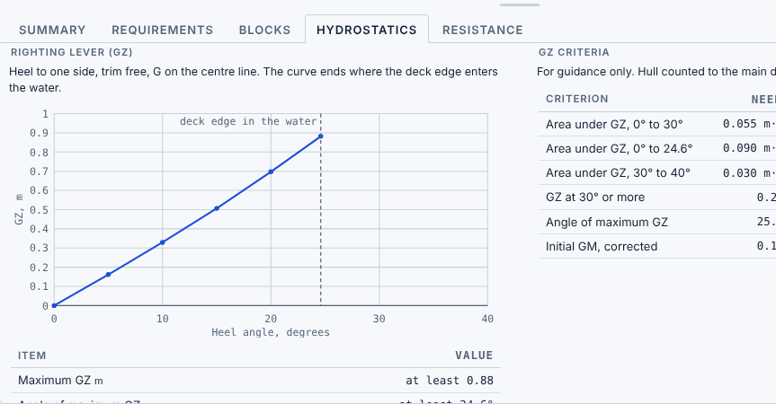

*Figure 5. The righting lever curve of the feeder. The curve ends where the deck edge enters the water, at about 25°.*

| Criterion | Limit |
|---|---|
| Area under GZ, 0° to 30° | at least 0.055 m·rad |
| Area under GZ, 0° to 40° | at least 0.09 m·rad |
| Area under GZ, 30° to 40° | at least 0.03 m·rad |
| GZ at 30° or more | at least 0.2 m |
| Angle of maximum GZ | at least 25° |
| Initial GM, corrected | at least 0.15 m |

When the deck edge enters the water before an angle, the criterion is worked out up to that angle only and is marked.

**Limits.**

- The model has no buoyancy above the main deck, no superstructure and no downflooding points. GZ beyond deck-edge immersion is not meaningful, so the curve stops there.
- G is taken on the centre line and at the height found from the blocks. The weights come from simple blocks and densities.
- There is no wind, wave, icing, passenger or damage case. The criteria are for guidance only and are not a class or flag-state assessment.
- Hull shape errors, a coarse table or a rough structure share affect KB, BM and KG directly, and so GM.

**References for 4.5**

- IMO (2008). International Code on Intact Stability, 2008 (2008 IS Code), Resolution MSC.267(85). International Maritime Organization, London.

### 4.6 Gross tonnage

The app estimates the gross tonnage by the formula of the 1969 International Convention on Tonnage Measurement of Ships (IMO, 1969):

GT = K₁ × V, with K₁ = 0.2 + 0.02 log₁₀ V

where V is the volume of all enclosed spaces in m³. In the app, V is the sum of the shape volumes (4.1) of the blocks that count. A block counts unless **Counts for GT (enclosed space)** is unticked in its properties, as for an open cargo deck, a crane or a mast. Gross tonnage can be used as a requirement.

**Limits.** The real measurement is made from the moulded volume of the enclosed spaces, with exemptions and rules for particular spaces, and it is done by the administration. Here, overlapping blocks count twice, and the result depends on how the blocks are drawn. It is an estimate, not a tonnage certificate.

**References for 4.6**

- IMO (1969). International Convention on Tonnage Measurement of Ships, 1969. International Maritime Organization, London.

### 4.7 Resistance (Holtrop)

**Purpose.** The Resistance tab estimates the calm-water resistance of a displacement hull against speed, to compare designs. It uses the method of Holtrop and Mennen (1982) with the later re-analysis of Holtrop (1984), which is based on regression of model tests and ship trials. The formulas used are listed in Appendix A.

**Inputs.** For a hull, the app reads from its hydrostatics at the draught T: LWL, BWL, Cb, Cm, Cwp and the longitudinal centre of buoyancy as a percentage of LWL, forward of midship of the waterline:

LCB % = (LCB − x_aft − LWL / 2) / LWL × 100

where x_aft is the aft end of the waterline. The same draught is used forward and aft. The tab sets:

- the **service speed**, in knots. The default is the speed at Froude number Fn = 0.2, rounded to a whole number of knots (at least 1 kn);
- the **afterbody form**: pram with gondola, V-shaped sections, normal sections, or U-shaped sections with a Hogner stern;
- the **transom**: whether the hull has an immersed transom;
- for a hull without a drawn bulb, an optional **assumed bulb**.

**Bulbous bow.** If the hull is a curves hull with a bulb drawn in the Hull view, the method uses the cross-section area A_BT of the bulb and the height h_B of its centre above the baseline, both measured from the drawn shape. Otherwise, with the assumed bulb ticked, A_BT = π (T/2)² / 7.7 and h_B = T/2, which are the defaults of the ShipLab Holtrop web app. Without a bulb there is no bulb resistance.

**Output.** The total resistance is drawn against speed, from zero to the larger of Fn = 0.45 and 1.2 times the service speed, with the Froude number along the top and a marker at the service speed. The table gives the total and its parts at the service speed: frictional, form, appendage, wave, bulbous, transom and correlation.

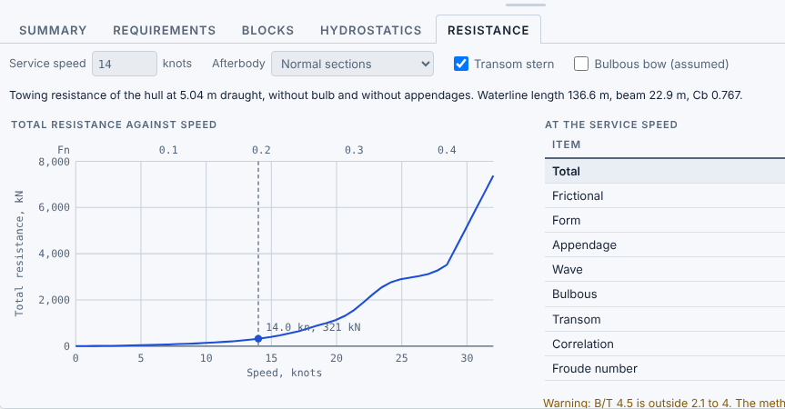

*Figure 6. The Resistance tab: total resistance against speed, with the Froude number along the top and the service speed marked.*

**Range of the method.** The app shows a warning when L/B is outside 3.9 to 15, B/T outside 2.1 to 4, or Cp outside 0.55 to 0.85. The result is then less accurate. For some shapes the formulas give no number, and then no curve is drawn.

**Limits.**

- It is an estimate for displacement ships in calm water. The wave term grows quickly at high speed.
- There are no appendages (the appendage term is zero), no propulsion and no power estimate.
- With several hulls, one hull is chosen at a time. The interaction between hulls is not included.
- Sea water at 1025 kg/m³ and a dynamic viscosity of 0.00122 Pa·s are fixed in this tab, whatever density is set for the hydrostatics. g = 9.81 m/s².
- The transom area is estimated from the draught and the beam, and the correlation term uses a fixed factor of 0.91, as in the ShipLab Holtrop web app (Flor, Monteiro and Gaspar).
- A deep bulb gives almost no bulb resistance of its own, because that term needs a bulb near the surface. It acts mostly by lowering the wave resistance.

**References for 4.7**

- Holtrop, J. and Mennen, G.G.J. (1982). An approximate power prediction method. *International Shipbuilding Progress*, 29(335), 166–170.
- Holtrop, J. (1984). A statistical re-analysis of resistance and propulsion data. *International Shipbuilding Progress*, 31(363), 272–276.

### 4.8 Seakeeping

**Purpose.** The Seakeeping tab estimates the motions of the ship in waves, to compare designs. It has two parts: the response in regular waves, for each wave frequency, and the response in one sea state, with significant and maximum values and the comparison with motion limits. It uses the closed-form expressions of Jensen, Mansour and Olsen (2004), for which the ship is a box of the waterline length L, the draught T and a breadth of the waterline breadth times C_b. The formulas are listed in Appendix D.

**Inputs.** For a hull, the app reads length, breadth, C_b and C_wp from its hydrostatics at the draught. The tab sets:

- the **speed**, in knots, shared with the Resistance tab;
- the **wave heading**, in degrees: 180 is head waves, 90 and 270 are beam waves, 0 is waves from astern;
- the **wave amplitude**, in metres, for the regular-wave charts;
- the **position**, where the vertical motion and acceleration are read: 0 is the centre of gravity, which the method takes at midlength, 100 the bow and −100 the stern, in % of half the length;
- for roll, **GM** (taken from the Hydrostatics tab unless typed), the **natural roll period** (0.85 B / √GM unless typed), the **damping** as a percentage of critical, and the **prismatic length ratio** δ (the length of the first of the two prismatic bodies of the roll model, as a share of the ship length, not greater than C_wp).

**Regular waves.** Six charts give, against wave frequency: the vertical motion and the vertical acceleration at the position, the pitch motion at the position, the heave, the wave-induced vertical bending moment at midship, and the roll. The values scale with the wave amplitude. Heave and pitch are taken 90° out of phase, and deep water is assumed.

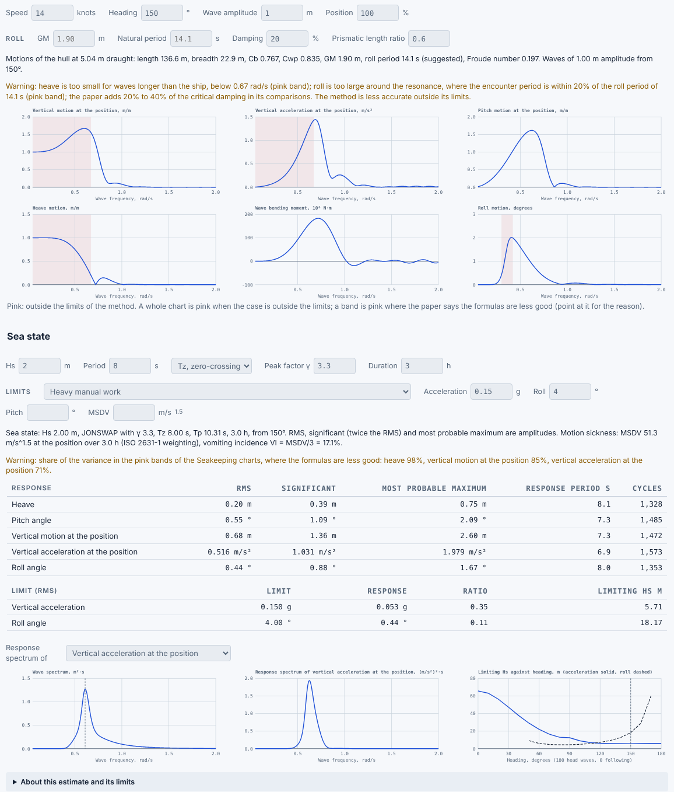

*Figure 7. The Seakeeping tab of the feeder: the six charts in regular waves, then the sea state, the statistics, the limits and the spectra.*

**Sea state.** The sea is described by a spectrum of Pierson–Moskowitz (peak factor γ = 1) or JONSWAP form (Eqs. 7.2 to 7.6 of Jensen, Mansour and Olsen, 2004), from the significant wave height H_s, a period and the peak factor γ (3.3 is the usual JONSWAP value, up to 6 for a narrow sea). The period can be given as the mean zero-crossing period T_z or the peak period T_p. The spectrum is scaled so that its area is exactly H_s²/16. The app warns when more than 1% of its energy lies outside 0.05 to 2.0 rad/s, the range of the calculation.

**Statistics.** Each response is taken as a stationary Gaussian process with the variance m₀ = ∫ Φ² S dω, where Φ is the response per metre of wave amplitude and S the wave spectrum. The table gives, for heave, pitch angle, vertical motion and acceleration at the position, and roll:

- the **RMS**, the square root of m₀;
- the **significant** amplitude, twice the RMS;
- the **most probable maximum** in the duration set, RMS √(2 ln N), from the Rayleigh distribution of the peaks, where N = 3600 × hours / T_r is the number of cycles and T_r = 2π √(m₀/m₂) the zero-crossing period of the response, with m₂ taken with the encounter frequency. The values are amplitudes.

The bending moment is not included: the paper treats it as non-linear and unsuited to this analysis. There is one sea state and one heading, with no scatter diagram, so there are no long-term values.

**Limits.** The RMS of the vertical acceleration (in g), of the roll and of the pitch (in degrees) can be compared with limits. A preset sets them, and every value stays editable. The presets are those quoted by Stevens and Parsons (2002) from NORDFORSK (1987), by type of work (light and heavy manual work, intellectual work, transit passengers, cruise liner) and by ship type and location, and from NATO STANAG 4154 (roll 4.0°, pitch 1.5°, acceleration 0.2 g). The lateral acceleration limits are not used, because the method has no sway. The **limiting H_s** is the wave height at which the response reaches the limit, for the period, heading and speed set. As the response grows in proportion to H_s, it is H_s × limit / RMS. A chart shows the limiting H_s against heading, from 0° to 180°.

**Motion sickness.** The motion sickness dose value (MSDV) is the square root of the exposure time times the RMS of the vertical acceleration at the position, weighted by the filter W_f of ISO 2631-1 (1997), which is most sensitive near 0.175 Hz and covers 0.08 to 0.63 Hz. The energy of each wave frequency is placed at its encounter frequency. The vomiting incidence is VI = K × MSDV with K = 1/3, in % (ISO 2631-1; Lawther and Griffin, 1987). ISO 2631-1 defines the MSDV for 20 minutes to 6 hours, and a warning shows outside that range. The presets are the limit of 30 m/s^1.5 of ABS (2021), taken to keep the incidence below 10%, and 45 m/s^1.5 for 6 hours from the ship trials of Taylor (2023). The weighting is implemented as in Appendix G of Taylor (2023), after Rimell and Mansfield (2007).

**Range of the method.** The paper compares its formulas with model tests of ships at Froude numbers from 0.13 to 0.84. The app marks in pink, and warns, where the case is outside the limits: B/T from 1 to 6 (roll); Froude number below 0.3 and C_b of at least 0.6 (bending moment); the prismatic length ratio above C_wp; beam waves, where the formulas give no pitch and too high a heave peak; and waves that overtake the ship (following and quartering seas), where the roll is not defined. Bands of a chart are pink where the paper says the formulas are less good: heave too small for waves longer than the ship, pitch too large for wave lengths near the ship length above Fn 0.2 (shown from 0.75 to 1.25 of it), and roll too large near resonance (shown where the encounter frequency is within 20% of the roll frequency). When more than 20% of the variance of a response lies in a pink band, the sea-state table warns.

**Limits.**

- It is a first estimate for comparing designs, not a strip theory or a model test.
- It is for one hull. Seakeeping of multihulls (catamarans, trimarans) is not possible.
- The ship is a box with the centre of gravity at midlength, with no appendages, bilge keels or active stabilisation, in deep water.
- Roll damping is the wave damping of the paper plus a viscous share typed in the tab.
- Sea water at 1025 kg/m³ is used, whatever density is set for the hydrostatics.

**References for 4.8**

- ABS (2021). *Guide for passenger comfort on ships*. American Bureau of Shipping.
- ISO 2631-1 (1997). *Mechanical vibration and shock: evaluation of human exposure to whole-body vibration, Part 1: General requirements*.
- Jensen, J.J., Mansour, A.E. and Olsen, A.S. (2004). Estimation of ship motions using closed-form expressions. *Ocean Engineering*, 31, 61–85.
- Lawther, A. and Griffin, M.J. (1987). Prediction of the incidence of motion sickness from the magnitude, frequency and duration of vertical oscillation. *Journal of the Acoustical Society of America*, 82(3), 957–966.
- Rimell, A.N. and Mansfield, N.J. (2007). Design of digital filters for frequency weightings required for risk assessments of workers exposed to vibration. *Industrial Health*, 45(4), 512–519.
- Stevens, S.C. and Parsons, M.G. (2002). Effects of motion at sea on crew performance: a survey. *Marine Technology*, 39(1), 29–47.
- Taylor, N.C. (2023). *A human cyber-physical system implementation for seafarers*. Doctoral dissertation, Stellenbosch University.

### 4.9 Structure

The Structure tab is a first check of the hull structure to the DNV Rules for Ships, Pt.3 Ch.2 (January 2015, ships with length less than 100 m). It is for learning and for comparing concepts. It is not a class check.

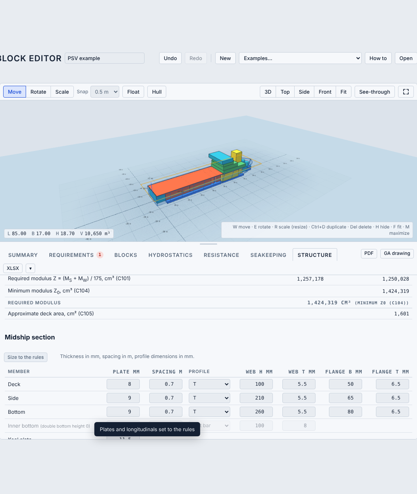

**Rule dimensions.** The rule length is L = 0.96 L_WL, with the aft perpendicular (AP) at the aft end of the waterline. B is the waterline breadth, D the depth, T the draught of the hull, and C_B = V / (L B T). The wave coefficient is C_W = 0.0792 L (m). The steel grade gives the material factor f1: NV-NS 1.00, NV-27 1.08, NV-32 1.28, NV-36 1.39 and NV-40 1.47. The service area R0 to RE reduces the wave bending moment by twice the percentage of Table C1 (0 to 50%) and the dynamic part of the local pressures by the percentage of Table B2 (0 to 50%). A corrosion addition t_k, zero by default, is added to the required thicknesses.

**Load along the ship.** The hull is cut into 120 strips. The weight per metre is the sum of the block masses, each spread uniformly over its length, and the structure share (or the steel weight), spread in proportion to the section area of the hull up to the deck. The buoyancy per metre is the density of the water times the immersed section area at the floating position of the Float state, with trim. The load is the weight minus the buoyancy. Its integral from the aft end is the shear force, and the integral of the shear force is the bending moment. The moment is positive in sagging, when the middle of the ship is heavier than its buoyancy. The weight and the buoyancy balance at the floating position, but the strips and the box shape of the blocks leave a small residual at the fore end. The residual is removed linearly, so that shear force and moment return to zero at the ends, and a warning is given if it is large.

**Rule moments and modulus.** Within 0.4 L amidships the rule stillwater moment is M_SO = 0.0052 L³ B (C_B + 0.7) kN·m, reduced to zero at the perpendiculars. The wave moment amidships is M_WO = 0.11 C_W L² B (C_B + 0.7) in sagging and 0.19 C_W L² B C_B in hogging (C_B not less than 0.6). It is applied from 0.4 L to 0.65 L from the AP, and reduced linearly to zero at the ends. The stillwater moment used is the larger of M_SO and the calculated value within 0.4 L amidships (Sec.4 B102). The required section modulus is Z = (M_S + M_W) / 175 × 10³ cm³, and not less than Z_0 = C_WO L² B (C_B + 0.7), with C_WO = 5.7 + 0.022 L (at least 7.0, reduced by the Table C1 percentage) and C_B not less than 0.5. The approximate deck area A = 0.11 L² B / D (cm²) is shown for comparison.

**Midship section.** The section is a box of breadth B and depth D. The inputs are the thickness of the deck, side, bottom and keel plates, an optional double bottom with an inner bottom plate, the spacing of the longitudinals of each plate, and their profile, flat bar or T (web height and thickness, flange breadth and thickness). A hatch share removes a part of the deck breadth. The area, the neutral axis and the moment of inertia of plates and longitudinals give the section modulus at the deck and at the bottom, which are compared with the required value. **Size to the rules** sets plates and T profiles to the rule values and raises the deck and bottom plates until the modulus is met. It is a starting point to edit.

**Local scantlings.** Pressures are taken at midship (k_s = 2), at half breadth. The sea pressure below the waterline is p1 = 10 h_0 + p_dp, above it p2 = p_dp − (4 + 0.2 k_s) h_0 (not below 6.25 + 0.025 L), and for the weather deck p = 0.8 (p_dp − (4 + 0.2 k_s) h_0), at least 5.0 kN/m². The plate thickness is t = 15.8 k_a s √(p / (σ f1)) + t_k, not less than the minimum thickness of the member. The modulus of a longitudinal is Z = 83 l² s p / (σ f1) cm³ (at least 15 cm³), against the modulus of the stiffener with a plate flange of one spacing. The allowable stress is 120 N/mm² for the plating within 0.4 L, and for the longitudinals from 95 N/mm² when the section modulus just meets the requirement to 160 N/mm² when it is twice the requirement (the side longitudinals: 160 N/mm² near the neutral axis). The web and flange thickness of the longitudinals is checked against the minimum. The table gives pressure, stress, required and chosen size and OK or not enough for each item.

**Steel weight.** The mass is the section area times 7.85 t/m³ times the hull length times an allowance factor (default 1.5) for the ends, floors, frames and bulkheads. A switch uses it in place of the structure share in the weights, the floating position and the stability (default off).

**References for 4.9**

- DNV (2015). *Rules for Classification of Ships, Part 3 Chapter 2: Hull structural design, ships with length less than 100 metres* (Sec.1 to 8). Det Norske Veritas AS, January 2015.

### 4.10 What if

The What if tab proposes changes to the ship so that one requirement is met, and shows what they cost in the other figures. It is a simplified form of the epoch-era idea of testing a design in more or less demanding scenarios (Ross and Rhodes, 2008; Gaspar et al., 2015): one requirement at a time is moved to a chosen value, and the ship is changed to follow. Clicking the tab opens a window with the 3D view, a panel of choices and the comparison.

**Choice of requirement and target.** One of the requirements is chosen, and a target is offered: the original, the shall, midway between the shall and the should, or the should. A value can also be typed. For a requirement of the type "at least" the target is higher than the original when the ship is to be larger, and lower when a smaller ship would still do.

**Scaled directions.** The directions in which the ship is scaled are ticked: length, beam, depth, or a combination. For a requirement on volume, mass or gross tonnage the factor F needed is spread equally, so that each of k ticked directions is scaled by F^(1/k). A requirement on area can be scaled in length and beam only. A requirement on length, beam or height scales the whole ship in that direction. If typed weights make the metric non-linear, the factor is found by iteration.

**What is scaled.** The blocks linked to the requirement are stretched along the ticked directions. Blocks beyond them move by the same amount, so that the layout stays closed, and blocks that span the stretch are stretched with it. Blocks with a typed weight and imported shapes are moved and not resized. The hulls follow the same stretch in length, in breadth (symmetric about the centreline) and in depth. Blocks that cannot be scaled (rotated by an angle other than a multiple of 90 degrees) stop the change, with a message.

**Result.** The changed ship is settled at its own level draught. The 3D view shows the original in a light colour beside the variant, and the original can be switched off. A table gives weight, draught, trim, heel, GM, gross tonnage, the main dimensions (length overall and at the waterline, beam, depth, displacement, L/B, B/T, L/D), the coefficients (C_B, C_M, C_P, C_WP, LCB and KB) and the value and status of every requirement. Bar plots show the change in percent against the original, and the value of each requirement against its shall and should lines.

**Saved variants.** A variant is saved with **Save**, with an optional name, and gets an id (V1 to V5). Up to five are kept in the project, and the tab shows their number. Saved variants are compared in the same table, plots and 3D view, can be shown or hidden one by one, applied to the project with **Apply**, and deleted. They are stored in the project file (Appendix C), and the PDF report and the Excel workbook list the original and the variants side by side.

**Pictures in the report.** The PDF report shows a small 3D picture of the original and of each saved variant, with its length, beam and depth, L/B, B/T, L/D, weight, draught and GM, followed by the comparison table. When no variant is saved, the report says so and shows instead the options that the What if tab offers for its requirement (to the shall, midway and to the should).

**What the requirements ask.** The PDF report also has a table, worked out when the report is made, of the ship with the blocks linked to each requirement scaled in length (or in its own direction, for length, beam and height) to the shall and to the should: the change in weight, the length, beam, draught, GM and the other requirements that are then not met. To keep the report quick, at most six requirements are taken (about half a second to a second for each target), and the rest are listed as not computed. They are not part of undo.

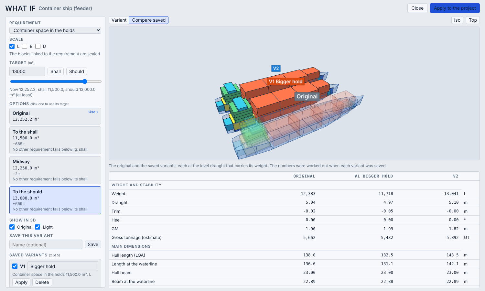

*Figure 8. The What if window: the original and two saved variants, with the comparison table.*

**References for 4.10**

- Gaspar, H.M., Brett, P.O., Erikstad, S.O. and Ross, A.M. (2015). Quantifying value robustness of OSV designs taking into consideration medium to long term stakeholders' expectations. 12th International Marine Design Conference (IMDC 2015), Tokyo.
- Ross, A.M. and Rhodes, D.H. (2008). Using natural value-centric time scales for conceptualizing system timelines through epoch-era analysis. INCOSE International Symposium 2008, Utrecht.

## 5. The Hull view

The Hull view is a full-screen editor for the shape of one hull. It is opened with the **Hull** button beside Float, with **Shift+H**, or with **Hull view…** in the hull panel. If the design has no hull, the button adds one first. The view shows the hull that is selected, or the first hull.

### 5.1 What it does

The hull is described by a few curves. The curves, or the sliders that draw them, are changed, and the app builds the table of offsets (60 stations by 24 heights) from them. **Apply** replaces the shape of the hull in the design. **Cancel** closes the view and leaves the hull as it was. After Apply the hull is a *curves hull*: the curves and the slider values are kept in the project file, so the view can be opened again and the work continued from them.

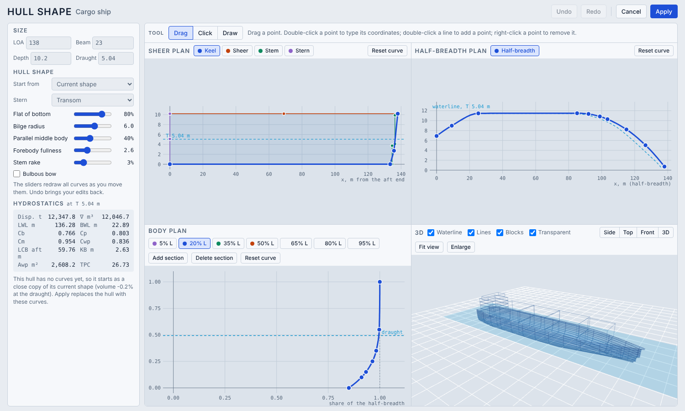

*Figure 9. The Hull view: sheer plan, half-breadth plan, body plan and 3D view, with the size, sliders and hydrostatics on the left.*

If the hull was a table hull or a parametric type, the view starts from a close copy of its shape, made as curves from the table (sampled 80 by 30). The copy is not exact. The view shows how much the volume differs from the old hull, and the difference stays small for ordinary hulls.

### 5.2 How the curves make a hull

Four sets of curves define the hull. All are smooth curves through control points, which do not overshoot between the points.

| View | Curves | Gives |
|---|---|---|
| Sheer plan | Keel, sheer, stem, stern | The profile: the keel line, the deck edge, and the outline of the bow and stern. |
| Half-breadth plan | One curve | The half-breadth along the length, at the deck. |
| Body plan | One curve per section (up to 20), each at a position as a share of the length | The shape of the cross-section, as the half-breadth shares against height shares. |

At a point x and height z, the half-breadth is the plan half-breadth at the position of x between the stem and the stern, times the section shape at that position and height, which is interpolated between the drawn sections. Rows and stations outside the keel, the deck, the stem or the stern have no hull.

The curves are limited to 24 points each, and the hull to 20 sections.

### 5.3 The sliders

The **Start from** list begins with *Current shape* and then offers hull presets: cargo ship, bulk carrier, offshore vessel, trawler, offshore patrol vessel, ro-pax ferry, tug, research vessel, workboat, slender hull and barge. A preset redraws all curves at the size that is set, without changing that size.

| Slider | Effect |
|---|---|
| Stern | Transom, round or cruiser stern |
| Flat of bottom | 0 is a V section, 100% a flat bottom |
| Bilge radius | Hard to round bilge |
| Parallel middle body | Share of the length with a constant section |
| Forebody fullness | Fullness of the bow sections |
| Stem rake | Slope of the stem |

The sliders redraw all curves, so manual edits are replaced when one is moved. Undo brings them back. The slider values are kept with the hull.

**Bulbous bow.** The *Bulbous bow* box adds an ellipsoid at the bow, below the waterline, blended into the hull. Its sliders set the length (how far it sticks out ahead of the stem, as a share of the length), the breadth (a share of the beam), and the height of its centre (a share of the draught). The curves do not change. The bulb adds to the length of the table, and is the bulb that the resistance calculation (4.7) reads.

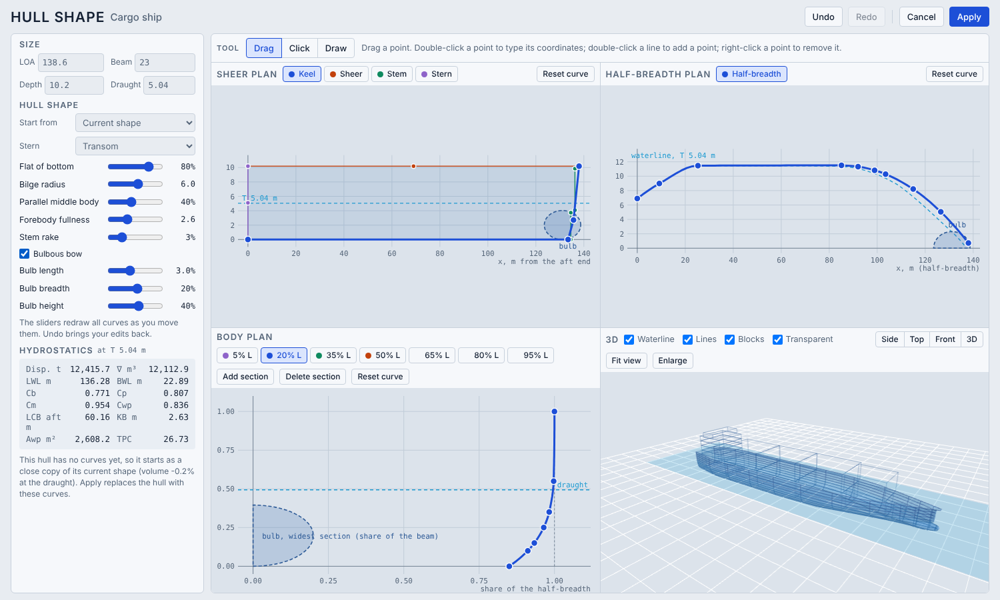

*Figure 10. The Hull view with a bulbous bow: the bulb shows dashed in the three views, and the sliders for its length, breadth and height are open.*

### 5.4 Editing the curves

The **Drag**, **Click** and **Draw** tools work in the three plan views.

- *Drag*: drag a point to move it. Double-click a point to type its coordinates. Double-click a line to add a point. Right-click a point, or press Delete, to remove it.
- *Click*: click to add a point on the selected curve. Right-click removes a point.
- *Draw*: draw a freehand line. It replaces the selected curve with a smooth fit.

In the body plan, the buttons above the plot (5% L, 20% L and so on) select the section to edit. **Add section** adds a section in the biggest gap, **Delete section** removes one, and the position of a section along the length can be changed. **Reset curve** puts the selected curve back to the shape that the slider values give.

### 5.5 Size, hydrostatics and the 3D view

The **Size** fields set the length, beam, depth and draught. With a bulb, the length is that of the whole table, bulb included. The **Hydrostatics** panel recalculates at every change: displacement, volume, LWL, BWL, Cb, Cp, Cm, Cwp, LCB, KB, waterplane area and TPC at the draught (as in 4.4).

The 3D view shows the hull with the waterline, the lines, and, optionally, the blocks as faint boxes inside it, to show whether they fit. The *Transparent* box makes the hull see-through. **Side**, **Top**, **Front** and **3D** set the view, **Fit view** (F) fits the hull, and **Maximize** makes the view fill the window (M or Esc goes back).

If the draught is locked because Float is on, Apply keeps the draught. Otherwise it sets the draught from the view.

Undo (Ctrl+Z) and Redo (Ctrl+Shift+Z) work within the view, with up to 100 steps.

### 5.6 Limits

- The hulls are smooth displacement hulls described by these curves. The hull is not checked for fairness or for hydrodynamic quality.
- The view does not open or save hull files, import offsets or show resistance. Those functions are in the main window.
- All sections are scaled by the same half-breadth plan curve, and the sections are interpolated between their positions.

---

## 6. Outputs

Everything the app calculates is available on screen, in the report, in the drawing, or in a file.

### 6.1 The tabs

| Tab | Shows |
|---|---|
| Summary | An assessment of the design: chips for requirements, weight, hull fit, stability and trim, a list of issues with a link to where to look, and a list of what passes. The thresholds are guides: weight margin within 1% of the displacement, blocks outside the hulls up to 2% (amber) and 10% (red) of the block volume below the main deck, and the three basic stability checks of 4.5. |
| Requirements | Each requirement with the achieved value, the status and the margin (4.2). |
| Blocks | The table of blocks, with size, position, rotation, group, density, fill and mass. |
| Hydrostatics | The floating condition, the hydrostatics of the hulls, the initial stability, the checks, and the GZ curve with its criteria. |
| Resistance | The curve of total resistance against speed and its parts (4.7). |
| Seakeeping | The ship motions in regular waves, and in a sea state: statistics, motion limits, limiting wave height and motion sickness (4.8). |
| What if | A window that scales the blocks linked to one requirement to a target between the shall and the should, compares the result with the original and keeps up to five variants (4.10). |
| Structure | The load, shear force and bending moment along the ship, the rule section modulus, a midship section, the local plate and stiffener sizes and a steel weight (4.9). |

### 6.2 PDF report

**PDF** makes a design report. It has the title page with the perspective view and the key figures and assessment, then the views (top, side, front), the requirements, the systems with area and volume, the gross tonnage, the hulls, the weight and centres of gravity, the floating condition, the hydrostatics and stability (with the GZ curve), the resistance, the seakeeping, the assumptions and limits, and an appendix with all blocks. All pages are portrait, and the wide tables are rotated.

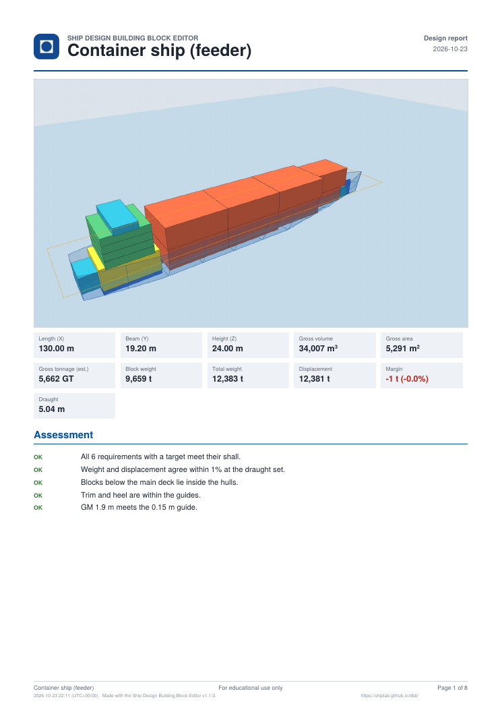

*Figure 11. First page of the PDF report.*

### 6.3 General arrangement drawing

**GA drawing** makes A3 sheets with the profile, a section, tables, the deck plans and, when there is a hull, the lines plan. It can be saved as a PDF, or as a DXF at full size in millimetres, to plot at the scale given on each sheet. The scale is chosen so that the length, the height and the beam fit the sheet, which also holds for wide multihulls.

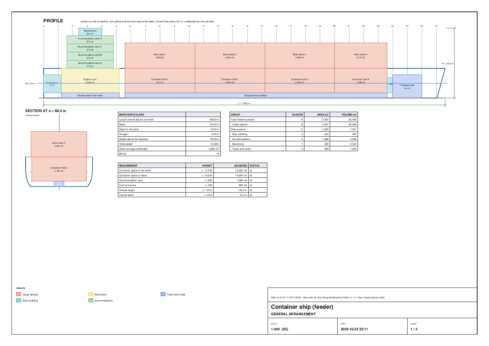

*Figure 12. First sheet of the general arrangement drawing: profile, section and tables.*

### 6.4 Excel workbook

**XLSX** saves the project as a workbook with sheets Summary, Project, Output, Blocks, Weight, Hydrostatics, GZ, Resistance, Seakeeping, Structure (single hull), Variants (when variants are saved), Offsets and Requirements. The masses and totals are formulas, so changing a density or a fill in Excel updates the weights. The other sheets hold values from the app at the time of export.

### 6.5 Project file and tables

**Save** writes the project as a JSON file with the imported shapes and the curves of hulls inside (3.7). A hull can be added from a table of offsets (CSV or pasted text, with the stations in the first row and the heights in the first column, blank for no hull), and the table of offsets of a hull can be shown and copied from the hull panel.

### 6.6 Imported shapes

A block can take the shape of a mesh from an STL file. The mesh is reduced on import. The volume, the centre of gravity and the plan area come from the mesh, and the block scales with its size. An example project, *PSV with STL parts*, shows a crane, a funnel and an A-frame.

---

## 7. Assumptions and limitations

This chapter gathers the assumptions of the app in one place. Each is explained where it is used, in chapters 3 and 4.

### 7.1 Purpose

The app is for teaching and early concept exploration. It shows how the pieces of a ship fit in space and weight, and how the choices change draught, trim, stability and resistance. It is not for design approval, class or flag-state documentation, or any safety-critical decision.

### 7.2 Blocks and weights

- A block is a simple shape with a size. Its volume is the shape factor times the volume of its box (4.1). Real spaces are more complex, and a block has no internal structure.
- Overlapping blocks are not detected. Their volumes, areas and weights all count, and for gross tonnage they count twice.
- Each block's weight acts at the centroid of its shape. Density and fill are uniform, and a typed mass replaces the calculation.
- Structure and outfitting are a share of the displacement (25% to begin with), put at the centroid of the hull up to the deck. It is not a weight estimate of the real structure.
- Blocks above the main deck are not checked against the hull. The envelope, and the requirements on length, beam and height, come from the box around all blocks, not from the hulls.

### 7.3 Hulls

- The hulls are smooth parametric shapes or shapes from a table of offsets, not faired lines. The hull in the Gunnerus example is an illustration, not the lines of the ship.
- Buoyancy comes only from the hulls, up to the main deck. Blocks outside the hulls, appendages and propellers add nothing, and superstructure gives no buoyancy at large heel.
- A curves hull is rebuilt as a table of 60 by 24 points. Hydrostatics are numerical integrals of that table (4.4), and a coarse table or an unusual shape reduces their accuracy.
- A copy of a table hull into curves is close, not exact.
- Hull fitting adds margins around the blocks (4.3). A hull fitted by the app is a starting point and not an optimum.

### 7.4 Floating and stability

- One water density and a flat sea are used. The draught follows Archimedes' principle.
- Trim and heel are found with a tilted water plane for all hulls together. A heavy off-centre load on a single hull may have no equilibrium within the range, and then the heel is shown as not found.
- GM is for small angles, upright, at the level draught that carries the weight. G is taken on the centre line for the GZ curve.
- Free surface is counted only for blocks that are marked, and a partly filled tank is a rectangular box with the size of the bounding box of the block. This overestimates round or tapered tanks.
- GZ ends at deck-edge immersion. There is no downflooding, wind, wave, icing, passenger or damage case.
- The checks are simple guides. They are not a stability assessment for class or flag state.

### 7.5 Gross tonnage

Gross tonnage is an estimate by the 1969 formula from the blocks that count as enclosed spaces. It is not a tonnage certificate (4.6).

### 7.6 Resistance

- The Holtrop method is a regression for displacement ships in calm water, and it is less accurate outside its range of L/B, B/T and Cp (4.7). It gives a first estimate for comparing designs.
- Appendages are not included, the draught is the same forward and aft, and a bulb is included only when it is drawn in the Hull view or assumed with the box in the tab.
- It is for one hull at a time. The interaction between hulls is not included.
- It gives the towing resistance only. There is no propulsion, no propeller or hull efficiency, and no sea margin.
- Sea water of 1025 kg/m³ is used in this tab whatever the water density is set to.

### 7.7 Seakeeping

- The method is a closed-form estimate for a ship taken as a box in deep water, and it gives a first estimate for comparing designs. It is less accurate outside its range, which the app marks in pink (4.8).
- It is for one hull at a time. Seakeeping of multihulls is not possible.
- The sea state is one spectrum and one heading. There is no scatter diagram and no long-term result. The bending moment is not given in a sea state.
- The motion limits are RMS values from the literature, and they are guides, not rules. Lateral acceleration is not checked.
- The motion sickness dose value is defined for 20 minutes to 6 hours. The incidence VI = MSDV/3 is a rough guide, and the incidence of motion sickness (MSI) is not calculated.

### 7.8 Structure

- The check is for one hull. Multihulls are not covered. The rules edition is that of 2015 for ships under 100 m, and a warning is given above 100 m.
- The load uses the weights and the buoyancy at the floating position only. Other loading conditions (ballast, partly filled tanks, harbour) are not run, and the wave moment is the rule value, not a calculated one.
- The block weight is spread uniformly over the length of the block, so the distribution is smooth where the real one is stepped.
- The midship section is a box with sides of constant thickness: no bilge, sheer strake, girders, transverses or superstructure. The plate flange of a longitudinal is one stiffener spacing. Net thicknesses are those entered.
- Local scantlings are checked at midship for the bottom, side and strength deck plating and longitudinals, the keel plate and the inner bottom minimum. Not covered: bulkheads, floors, girders, frames, tank structure, superstructure, buckling (Sec.12), shear strength, fatigue and finite element analysis.
- The steel weight is a rough estimate. The allowance factor for the ends and the transverse structure is a guess to be set from similar ships.

### 7.9 What if

- The change is a scaling of the blocks linked to one requirement, with the hulls following. It is not a new design: nothing is re-arranged, and the machinery, tanks and structure keep their sizes unless they are linked to the requirement.
- One requirement is changed at a time. Other requirements, including those on length, beam and gross tonnage, can become not met, and the table shows it.
- Blocks with a typed weight and imported shapes keep their size. If the metric depends on them the target may not be reached, and a message says so.
- The variants are at the level draught that carries their weight, with the weights of the blocks as given. The structure share, the resistance and the seakeeping are not recalculated for them; the variant is applied to the project to do that.
- Epochs and eras (time-changing needs and contexts) are not modelled. The tab shows only how the ship could change to meet a different level of one requirement.
- At most five variants are kept.

### 7.10 Software

The app runs in the browser. The calculations are covered by an automatic test suite, and the Holtrop and seakeeping code is tested against the web apps it was taken from. They have not been validated against model tests or ship trials. Check any result that matters with other tools before using it.

---

## 8. Reference

### 8.1 Glossary

| Term | Meaning |
|---|---|
| Baseline | The level z = 0 at the underside of the hull. All heights are measured up from it. |
| Block | A space or item with a shape, size and position. Its volume and plan area count towards the design. |
| Group | A branch of the system breakdown. Totals roll up the tree. |
| Requirement | A target on volume, area or weight of tagged blocks, or on length, beam, height, total weight or gross tonnage. *Shall* must be met, *should* is desirable. |
| Depth | Height of the main deck above the baseline. |
| Draught (T) | Height of the waterline above the baseline. One draught for the whole vessel. |
| Freeboard | Depth minus draught. |
| Displaced volume (∇), displacement (Δ) | The hull volume below the waterline, and the mass of the water it displaces. |
| Level draught | The draught at which the displacement equals the total weight, upright and without trim. |
| Float | A switch: the draught and trim are solved from the total weight each time the model changes. |
| LWL, BWL | Length and maximum beam of the waterline. |
| Cb, Cp, Cm, Cwp | Block, prismatic, midship section and waterplane coefficients (4.4). |
| Awp, TPC | Waterplane area, and the mass that sinks the vessel 1 cm. |
| LCB, TCB, KB | Centre of buoyancy: from the aft end, to port of the centreline, and above the baseline. |
| LCF | Longitudinal centre of flotation, the centroid of the waterplane. |
| LCG, TCG, VCG (KG) | Centre of gravity, in the same directions. |
| BM, KM, GM | Metacentric radius, height of the metacentre (KB + BM), and initial metacentric height (KM − KG). |
| GZ | Righting lever: the sideways distance between the centres of buoyancy and gravity when heeled. |
| Free surface | The effect of liquid that moves in a partly filled tank, which acts like a higher centre of gravity. |
| Trim | Aft draught minus forward draught. |
| Heel | List angle, positive to port. |
| Margin | Displacement minus total weight. |
| Gross tonnage (GT) | An estimate of the enclosed volume of the ship by the 1969 formula. |
| Curves hull | A hull made in the Hull view. It keeps its curves and works as a table of offsets everywhere else. |
| Sheer plan, half-breadth plan, body plan | The side view, the view from above, and the cross-sections of the hull. |
| Froude number (Fn) | v / √(g · LWL). |
| Imported shape (STL) | A mesh from an STL file, used as one block. |
| Wave heading | Direction the waves come from, relative to the bow, in degrees: 180 is head waves, 0 is waves from astern (4.8). |
| H_s, T_z, T_p | Significant wave height, mean zero-crossing period and peak period of a sea state. |
| γ (peak factor) | Peak enhancement of the JONSWAP spectrum. 1 gives Pierson–Moskowitz, 3.3 is the usual value. |
| RMS, significant, most probable maximum | Standard deviation of a response, twice that, and the largest amplitude expected in the duration, RMS √(2 ln N). |
| Limiting H_s | The significant wave height at which a response reaches its limit. |
| What if | A change of the ship to meet one requirement at a target between the shall and the should, by scaling the blocks linked to it (4.10). |
| Variant | A what if saved in the project with an id (V1 to V5) and an optional name (4.10). |
| Structure check | First check of the hull structure to the DNV rules (2015, ships under 100 m): bending moments, section modulus, midship section, local plate and stiffener sizes, steel weight (4.9). |
| Sagging, hogging | Bending of the hull girder with the middle heavier than its buoyancy (sagging, positive) or lighter (hogging). |
| M_SO, M_WO | DNV rule stillwater moment and wave bending moment amidships, in kN·m. |
| Section modulus Z | Modulus of the midship section at deck or bottom, cm³, required as (M_S + M_W)/175, and not less than Z_0. |
| Material factor f1 | Steel strength grade factor: NV-NS 1.00 to NV-40 1.47. |
| Service area | R0 to RE, a restriction that reduces the wave moment and the dynamic pressures. |
| Corrosion addition t_k | Thickness in mm added to every required thickness. |
| MSDV, VI | Motion sickness dose value, in m/s^1.5, and vomiting incidence VI = MSDV/3 in % (ISO 2631-1). |

The same terms, with more detail, are in the **How to** window of the app, under **Glossary**. Hovering over a table heading shows a short explanation.

### 8.2 Keyboard and mouse

| Key or action | Effect |
|---|---|
| W / E / R | Move, rotate, scale the selection |
| H | Hide or show the selected block or hull |
| Shift+H | Open the hull view (adds a hull if there is none) |
| F or 5 | Fit the model in the view |
| M | Maximize the 3D view to the whole window, and back (Esc also goes back) |
| 1 / 2 / 3 / 4 | 3D, top, side, front view |
| Ctrl+D | Duplicate the block (adds a mirrored hull when a hull is selected) |
| Delete or Backspace | Delete the selected block or hull |
| Esc | Deselect, and then leave the maximized 3D view |
| Ctrl+Z | Undo |
| Ctrl+Shift+Z or Ctrl+Y | Redo |
| Drag the background | Orbit |
| Right-drag | Pan |
| Mouse wheel | Zoom |
| Click a block or a hierarchy row | Select it |
| Column titles in the Blocks tab | Sort: once, twice to reverse, a third time for the original order |

Keys work when no text field is focused. In the Hull view, F fits the hull, M maximizes the 3D view, Ctrl+Z and Ctrl+Shift+Z (or Ctrl+Y) undo and redo, Delete removes the selected point, and Esc leaves the maximized 3D view.

### 8.3 File formats

**Project file (JSON).** *Save* writes a text file with the format name `dbb-block-editor` and a version number (2). It holds the name, the groups, the requirements, the blocks (id, name, group, shape, size, position, rotation, density, fill, mass override, free surface, deck, GT, area override), the imported shapes used by the blocks, the water density, the draught, the Float switch, the resistance settings, the seakeeping settings, the structure share, and the hulls. A curves hull also holds its curves (`hullGen`) and slider values (`hullGenParams`). A summary of the computed results (weight, hydrostatics, stability) is written too, for reading by other programs, and is ignored on opening. Units are metres, tonnes and degrees. Axes: x forward from the aft end, y to port from the centreline, z up from the baseline. Block positions are block centres, and rotation is Euler XYZ in degrees. A file with a newer version number opens with a warning, and unreadable parts are skipped with a message.

**Table of offsets (CSV).** The first row has the stations (m, from the aft end), the first column has the heights (m, from the baseline), and the cells hold the half-breadths in metres. A blank cell means no hull. Two layouts are read, and the Offsets window copies the other one (Appendix B).

**STL.** ASCII or binary STL. The unit of the file (mm, cm, m or inch) is chosen on import, and the mesh is reduced.

**Excel workbook (XLSX).** The sheets are Summary, Project, Output, Blocks, Weight, Hydrostatics, GZ, Resistance, Seakeeping, Structure, Variants, Offsets and Requirements (6.4).

**PDF report and GA drawing.** PDF pages are portrait, with wide tables rotated. The GA drawing is saved as PDF or as DXF at full size in millimetres (6.2, 6.3).

---

## Appendix A. Holtrop formulas as used in the app

Symbols: L = LWL, B = BWL, T = draught (the same forward and aft), ∇ = L B T C_B, C_P = C_B / C_M, LCB in % of L. ρ = 1025 kg/m³, μ = 0.00122 Pa·s, g = 9.81 m/s², v in m/s (1 kn = 0.514444 m/s), Fn = v / √(g L). The wetted surface is S.

**Hull parameters**

- Run length: L_R = L [1 − C_P + 0.06 C_P (LCB/100) / (4 C_P − 1)]
- Wetted surface: S = L (2T + B) √C_M (0.453 + 0.4425 C_B − 0.2862 C_M − 0.003467 B/T + 0.3696 C_WP) + 2.38 A_BT / C_B
- Transom area (when there is a transom): A_T = 0.95 (T − 0.9225 T) × 0.89 B

**Friction and form**

- Reynolds number Re = ρ L v / μ and friction coefficient C_F = 0.075 / (log₁₀ Re − 2)²
- Frictional resistance R_F = ½ ρ v² S C_F
- Form factor: (1 + k₁) = 0.93 + 0.487118 c₁₄ (B/L)^1.06806 (T/L)^0.46106 (L/L_R)^0.121563 (L³/∇)^0.36486 (1 − C_P)^−0.604247
- c₁₄ = 0.725 (pram with gondola), 0.89 (V-shaped), 1 (normal), 1.11 (U-shaped, Hogner stern)
- The form resistance is (1 + k₁) R_F − R_F

**Wave resistance**

- c₇ = 0.229577 (B/L)^(1/3) for B/L < 0.11, B/L for 0.11 ≤ B/L < 0.25, and 0.5 − 0.0625 L/B above
- i_E = 1 + 89 exp[−(L/B)^0.80856 (1 − C_WP)^0.30484 (1 − C_P − 0.0225 LCB/100)^0.6367 (L_R/B)^0.34574 (100 ∇/L³)^0.16302]
- c₁ = 2223105 c₇^3.78613 (T/B)^1.07961 (90 − i_E)^−1.37565
- c₃ = 0.56 A_BT^1.5 / [B T (0.31 √A_BT + T − h_B)] and c₂ = exp(−1.89 √c₃)
- c₅ = 1 − 0.8 A_T / (B T C_M)
- c₁₅ = −1.69385 for L³/∇ < 512; −1.69385 + (L/∇^(1/3) − 8) / 2.36 for 512 ≤ L³/∇ < 1726.91; 0 above
- c₁₆ = 8.07981 C_P − 13.8673 C_P² + 6.984388 C_P³ for C_P < 0.8, and 1.73014 − 0.7067 C_P above
- c₁₇ = 6919.3 C_M^−1.3346 (∇/L³)^2.00977 (L/B − 2)^1.40692
- m₁ = 0.0140407 L/T − 1.75254 ∇^(1/3)/L − 4.79323 B/L − c₁₆
- m₃ = −7.2035 (B/L)^0.326869 (T/B)^0.605375
- λ = 1.446 C_P − 0.36 for L/B > 12, and 1.446 C_P − 0.03 L/B otherwise
- m₄ = 0.4 c₁₅ exp(−0.034 Fn^−3.29)
- R_W,a = c₁ c₂ c₅ ∇ ρ g exp[m₁ Fn^−0.9 + m₄ cos(λ Fn^−2)]
- R_W,b = c₁₇ c₂ c₅ ∇ ρ g exp[m₃ Fn^−0.9 + m₄ cos(λ Fn^−2)]
- R_W = R_W,a for Fn < 0.4; R_W,a(0.4) + (10 Fn − 4)[R_W,b(0.55) − R_W,a(0.4)] / 1.5 for 0.4 ≤ Fn ≤ 0.55; R_W,b for Fn > 0.55

**Bulb**

- P_B = 0.56 √A_BT / (T − 1.5 h_B) and Fn_i = v / √[g (T − h_B − 0.25 √A_BT) + 0.15 v²]
- R_B = 0.11 exp(−3 P_B^−2) Fn_i³ A_BT^1.5 ρ g / (1 + Fn_i²), and zero when A_BT = 0

**Transom**

- Fn_T = v / √[2 g A_T / (B + B C_WP)]
- c₆ = 0.2 (1 − 0.2 Fn_T) for Fn_T < 5, and 0 otherwise
- R_TR = ½ ρ v² A_T c₆

**Model–ship correlation**

- c₄ = min(T/L, 0.04)
- C_A = 0.006 (L + 100)^−0.16 − 0.00205 + 0.003 √(L/7.5) C_B⁴ c₂ (0.04 − c₄)
- R_A = 0.91 × ½ ρ v² S C_A

**Total**

R_T = (1 + k₁) R_F + R_APP + R_W + R_B + R_TR + R_A

with R_APP = 0 because no appendages are included.

The formulation follows the ShipLab Holtrop web app (Flor, Monteiro and Gaspar), and the app's code gives the same results as that code (checked by a test).

**References for Appendix A**: as for 4.7.

---

## Appendix B. Table of offsets as input and output

A hull can be added from a table of offsets (**Hull from table…** in the hull panel), and the table of any hull can be shown and copied (**Offsets**). This appendix describes the logic of both.

### B.1 What the table holds

A table of offsets gives the half-breadth of the hull, in metres, on a grid of stations along the length and heights above the baseline. Only one side is given. The hull is taken as symmetric about its centre line.

| | x₁ | x₂ | … | xₙ |
|---|---|---|---|---|
| z₁ | y₁₁ | y₁₂ | … | y₁ₙ |
| z₂ | y₂₁ | y₂₂ | … | y₂ₙ |
| … | | | | |

A blank cell means that there is no hull at that station and height. A cell with a value of zero is a point of the hull on the centre line, which is not the same as no hull.

### B.2 Input layout

The input is CSV or text pasted in the box, or a file opened with **Open file…** (.csv, .tsv or .txt). Two layouts are read.

**Heights down, stations across (the layout of the example `container-ship-offsets.csv`).** The first row has the station positions x in metres from the first column on. The first column has the heights z in metres. The cell at the top left is ignored. The other cells are half-breadths.

```
,0,10,20,30,40
0,,3.1,4.0,3.2,
2,1.5,4.2,5.0,4.4,2.0
4,3.0,5.1,5.4,5.2,3.6
```

**Stations down, heights across (the layout of the Offsets window).** The first cell of the first row starts with "Station". The second column has the station positions x. From the third column on, the first row has the heights, written as numbers or as "z 2.00". The cells are half-breadths.

```
Station,x,z 0.00,z 2.00,z 4.00
0,0,,1.5,3.0
1,10,3.1,4.2,5.1
```

The reading rules are the same in both layouts.

- The separator is a semicolon, a tab or a comma, whichever gives more than two fields in the first row.
- A decimal comma is accepted. Quotation marks are removed.
- A dash ( - ) or an empty cell means no hull.
- Empty lines are skipped. At least a header row and two further rows are needed.
- The heights are sorted from the lowest to the highest, whatever their order in the file.
- A negative half-breadth becomes zero.

### B.3 Checks

The table is accepted when it meets these conditions. The dialog shows the first problem it finds, and the **Add hull** button stays off until the table is accepted.

- All stations, heights and half-breadths that are filled in are numbers.
- There are 2 to 400 stations and 2 to 200 heights.
- The stations increase from left to right, and the heights differ from each other.
- Every height has hull at one station at least, and some half-breadth is positive.

### B.4 From the table to a hull

1. **Origin.** The x origin is moved to the first station that has hull at any height, so the hull starts at x = 0. Its length L is the distance to the last station that has hull.
2. **Depth.** The hull depth is the highest height whose row has hull at 90% or more of the largest number of stations in any row. This is the suggestion shown in the *Depth* field and can be changed. Rows above the depth are cut. If the lowest row is above the baseline, a row at z = 0 is added as a copy of it. If the highest row is below the depth, it is repeated up to the depth.
3. **Draught.** For the first hull in a design the suggestion is 55% of the depth, to be changed in the *Draught* field. Later hulls take the draught of the design.
4. **Size.** The beam is twice the largest half-breadth. The hull takes its length, beam and depth from the table, and these fields are shown in the hull panel. Changing them scales the whole table in proportion (length by loa / L, beam by beam / B, depth by depth / D). This is why a table hull can be resized without a new table.
5. **Position.** The first hull is put at x = 0 on the centre line. A later hull is put beside the others, 1 m clear of the outermost one. Its position is then set in the panel.
6. **Name.** The hull takes the name of the file, if the table was read from one.

### B.5 How the app reads the table

For each height, the app finds the first and last station with hull. These are the ends of the hull at that height, and they are interpolated linearly between two heights. Between two stations the half-breadth is linear in x, and between two heights it is linear in z. A blank cell between two stations counts as zero in the interpolation. The half-breadth is never more than half of the beam. The same table is the basis of the volume, hydrostatics, floating and stability calculations (chapter 4), so the quality of the table sets the quality of the results.

### B.6 Practical points

- Give the keel row (z = 0) and a row at the main deck, so no part of the hull is extrapolated.
- Use more stations where the hull changes shape quickly, at the bow and the stern. The stations do not have to be equally spaced.
- Leave the cells outside the hull blank, and do not fill them with zeros.
- A bulb or a flat transom is shown as far as the grid resolves it. Fine details between the grid lines are lost.
- Heights in a file with the keel below zero are cut at z = 0. The heights must start from the baseline of the hull.

### B.7 Output

**Offsets window.** The table shows the hull on a new grid: 10, 20 or 40 intervals along the length (stations numbered from 0, with x from the aft end of the hull) and 5, 10 or 20 intervals in height (z from the baseline). The values are half-breadths, with "-" where there is no hull. **Copy** puts the table on the clipboard as tab-separated text, in the *stations down, heights across* layout of B.2. It can be pasted into a spreadsheet and into the *Hull from table…* box of another design.

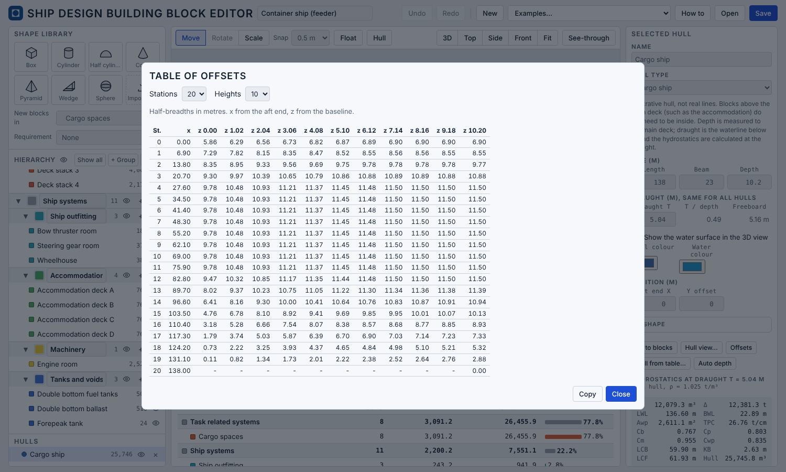

*Figure 13. The Offsets window of the feeder, with 20 stations and 10 heights.*

**Excel and PDF.** The Excel workbook has an *Offsets* sheet with one such table for each hull, and the PDF report has the table of offsets in the section on the hulls.

**Project file.** A table hull is saved with its full table (Appendix C).

**Hull from curves.** A curves hull (chapter 5) is also a table, built at 60 stations by 24 heights.

---

## Appendix C. The project file (JSON)

**Save** writes the project as a text file in JSON. It can be read by other programs, and edited with care. This appendix lists the fields and the rules that apply when a file is opened.

### C.1 Conventions

- Units: metres, tonnes, degrees. The water density is in t/m³.
- Axes: x forward from the aft end, y to port from the centre line, z up from the baseline.
- The position of a block is the position of its centre. The rotation is given by Euler angles about X, Y and Z, in degrees.
- Numbers are rounded to four decimals.

### C.2 Top level

| Field | Content |
|---|---|
| `app` | `"dbb-block-editor"`. A file with another value is refused. |
| `version` | Format version, 2 now. A newer file opens with a warning. |
| `name` | Name of the design. |
| `units`, `axes`, `taxonomy` | Text that describes the conventions. They are for the reader and ignored on opening. |
| `shapes` | The shape library with the volume factor and the plan factor of each shape. For information only. |
| `customShapes` | The imported (STL) shapes that blocks use. |
| `groups` | The system breakdown. |
| `requirements` | The requirements. |
| `waterDensity` | Water density, t/m³ (1.025 as default). |
| `draught` | Draught of the design, m. |
| `waterline` | Whether the waterline is drawn in 3D. |
| `float` | The Float switch. |
| `resistance` | Settings of the Resistance tab. |
| `seakeeping` | Settings of the Seakeeping tab (C.7). |
| `structurePercent` | Structure and outfitting as a percentage of the displacement (25 as default). |
| `weight` | Totals of the weight calculation. For information only. |
| `variants` | The saved what if variants, up to five: `id`, `name`, the requirement, the target, the scaled directions, the numbers and the full project of the variant. |
| `hulls` | The hulls. |
| `blocks` | The blocks. |

### C.3 Groups

Each group has `id`, `name`, `color` (a hex colour), `parent` (the `id` of another group, or `null` for a top-level group), `visible`, and `density` (t/m³, or `null` to follow the parent group).

### C.4 Requirements

Each requirement has `id`, `name`, `metric`, `sense`, `shall` and `should`. The metric is one of `volume`, `area`, `mass`, `length`, `beam`, `height`, `totalmass` and `gt`. The sense is `min` (at least) or `max` (at most). The targets are numbers, or `null` when not set. A block is linked to a requirement by the `reqs` list of the block.

### C.5 Blocks

| Field | Content |
|---|---|
| `id`, `name` | Identifier and name. |
| `shape` | `box`, `cylinder`, `halfcyl`, `cone`, `pyramid`, `wedge`, `sphere`, or the `id` of an imported shape. |
| `group` | The `id` of a group. |
| `reqs` | List of the `id` of the requirements that the block serves. |
| `position`, `size`, `rotation` | Three numbers each: x, y, z of the centre in m, length, beam and height in m (before rotation), and rotation in degrees. |
| `areaOverride` | A typed plan area in m², or `null` to calculate it. |
| `hidden` | Hidden in the view (does not change the calculations). |
| `density` | t/m³, or `null` to follow the group. |
| `fill` | Percentage, 0 to 100. |
| `massOverride` | A typed mass in t, or `null`. |
| `freeSurface` | The block is taken as a tank with free surface (4.5). |
| `deck` | The top of the block defines the main deck. |
| `gt` | The block counts for the gross tonnage. |
| `computed` | Volume, area, density, mass and centre of gravity, for information only. |

### C.6 Hulls

| Field | Content |
|---|---|
| `id`, `name`, `visible` | Identifier, name, visibility. |
| `type` | `osv`, `research`, `cargo`, `demihull`, `barge` or `offsets`. |
| `x`, `y` | Position of the aft end and of the centre line. |
| `loa`, `beam`, `depth`, `draught` | Size in m. |
| `shape` | Optional values that override the parameters of the hull type (flat of bottom, bilge hardness, flare, parallel body, bow fullness, stem width, stem rake, transom width, stern run, stern rake). Values outside the ranges of the sliders are clipped. |
| `offsets` | For `offsets` hulls: `zs` (heights), `xs` (stations from the aft end) and `halfBreadth` (a list of rows, one for each height, with `null` where there is no hull). The rules of Appendix B apply. |
| `library` | The name of a library hull, if the hull came from one. |
| `hullGen`, `hullGenParams` | For a curves hull: the curves (keel, deck line, stem, stern, plan, sections, bulb) and the slider values of the Hull view (5.1). |
| `computed` | Volume to the deck, displaced volume and hydrostatics at the draught, for information only. |

### C.7 Other settings

`resistance` holds `serviceSpeed` (knots, or `null` for the speed at Fn = 0.2), `afterbody` (1 to 4: pram with gondola, V-shaped, normal, U-shaped with Hogner stern), `transom` (true or false) and `bulb` (true if a bulb is assumed).

`seakeeping` holds the settings of the Seakeeping tab. Every field can be `null`, which gives the default in brackets. For the regular waves: `heading` (degrees, 150), `waveAmplitude` (m, 1), `position` (% of half the length, 100), `damping` (% of critical, 20), `prismaticLengthRatio` (0.6), `rollPeriod` (s, or `null` for 0.85 B / √GM) and `gm` (m, or `null` for the Hydrostatics value). For the sea state: `hs` (m, 3), `period` (s, 8), `periodType` (`"Tz"` or `"Tp"`), `gamma` (1 to 6, 3.3) and `hours` (3). For the limits: `limitAcceleration` (g, RMS), `limitRoll` and `limitPitch` (degrees, RMS), `limitMsdv` (m/s^1.5) and `limitSet` (the identifier of the preset chosen, or `"own"`). The speed is the service speed of `resistance`.

### C.8 Rules when a file is opened

The app reads the file with care and does not stop for most errors. It uses the following rules, and lists what it changed in a message.

- A file with `app` other than `dbb-block-editor` is refused.
- Fields that are missing or not valid take default values. Sizes have a lower limit of 0.01 m, and fill is limited to 0 to 100.
- A block with an unknown shape becomes a box. A block with a group that does not exist is moved to the first group without sub-groups. A block entry that cannot be read is skipped.
- Duplicate identifiers are replaced by new ones. A link to a requirement that does not exist is dropped. Cycles in the group tree are broken.
- If the file has no groups, the default groups are added.
- A hull of unknown type is ignored. A table hull whose table cannot be read is ignored. Curves that cannot be read leave the hull as a table hull. The editor allows up to five hulls.
- Only one block can define the main deck. After opening, the draught is checked against the depth of the hulls.
- The fields marked "for information only" are not read, so changing them has no effect.

### C.9 Making a file by hand or by a program

A minimal file needs `app`, `version`, a list of `groups` and a list of `blocks`. Everything else takes defaults. A program that writes a file can leave out the `computed`, `weight`, `shapes`, `units` and `axes` fields.


---

## Appendix D. Seakeeping formulas as used in the app

Symbols: L = LWL, B₀ = BWL, T = draught, C_b and C_wp from the hydrostatics, B = B₀ C_b (breadth of the box), ρ = 1025 kg/m³, g = 9.81 m/s², V the speed in m/s, Fn = V / √(g L), β the wave heading (180° head waves), a the wave amplitude, ω the wave frequency in rad/s. The formulas are those of Jensen, Mansour and Olsen (2004), in the form of the ShipLab ship motion web app.

**Wave and encounter**

- Wave number k = ω² / g, k_e = |k cos β|, and α = 1 − Fn √(kL) cos β
- Encounter frequency ω_e = ω α
- Sectional damping term N = 2 sin(½ k B α²) exp(−k T α²)

**Heave, pitch, vertical motion and acceleration**

- f = √[(1 − kT)² + (N² / (k B α³))²]
- Wave force on heave F = e^(−kT) f · [2 / (k_e L)] sin(k_e L / 2)
- Wave moment on pitch G = e^(−kT) f · [24 / ((k_e L)² L)] [sin(k_e L / 2) − (k_e L / 2) cos(k_e L / 2)]
- Dynamic factor η = 1 / √[(1 − 2 k T α²)² + (N² / (k B α²))²]
- Heave h = a η |F| and pitch angle θ = a η |G| (radians; shown in degrees)
- Vertical motion at the distance x from the centre of gravity, x = L · pos / 200: z = √(h² + θ² x²)
- Vertical acceleration at that position: a_z = α² k g z
- Pitch motion at the position: θ x

**Wave bending moment at midship**

- φ = 2.5 (1 − max(0.6, C_b)), F_Cb = (1 − φ)² + 0.6 α (2 − φ), F_v = 1 + 3 Fn²
- M = a e^(−kT) {(1 − kT) / (k_e L)²} [1 − cos(k_e L / 2) − (k_e L / 4) sin(k_e L / 2)] F_v F_Cb |cos β|^(1/3) ρ g B₀ L², in N·m (shown in 10⁶ N·m)

**Roll.** The ship is two prismatic bodies of the same draught, the first of length δ L and breadth B₀, the second narrower. With δ the prismatic length ratio:

- b_r = (C_wp − δ) / (1 − δ), B₁ = b_r B₀, A₀ = C_b B₀ T / (δ + b_r (1 − δ)), A₁ = b_r A₀
- Sectional damping of body i (i = 0, 1): b_i = ρ A_i B_i² c_a exp(c_b ω_e^(−1.3)) ω_e^(c_d) / √(B_i / (2g)), with, for B_i / T = r: if r > 3, c_a = 0.256 r − 0.286, c_b = −0.11 r − 2.55, c_d = 0.033 r − 1.419; otherwise c_a = −3.94 r + 13.69, c_b = −2.12 r − 1.89, c_d = 1.16 r − 7.97
- d_r = √(b₁ / b₀) and wave damping B₄₄ = L b₀ [δ + (b₁ / b₀)(1 − δ)]
- Restoring C₄₄ = ρ g C_b L B₀ T GM, and total damping B_t = B₄₄ + C₄₄ T_n ζ / π, with T_n the natural roll period and ζ the extra damping as a fraction of critical
- Excitation, beam waves: E = √(ρ g² b₀ / ω_e) [δ + d_r (1 − δ)] L
- Excitation otherwise: E = |sin β| √(ρ g² / ω_e) √b₀ (2 / k_e) √(s₁ + s₂ + s₃), with s₁ = sin²(δ L k_e / 2), s₂ = d_r² sin²((1 − δ) L k_e / 2), s₃ = 2 d_r sin(δ L k_e / 2) sin((1 − δ) L k_e / 2) cos(L k_e / 2)
- Roll angle φ_r = a E / √[(1 − (ω_e T_n / 2π)²)² C₄₄² + (ω_e B_t)²], in radians (shown in degrees). It is not defined when ω_e ≤ 0.

**Wave spectrum.** With γ the peak factor, T_s the mean period and H_s the significant wave height:

- T_s = T_z √[(10.89 + γ)(5 + γ)] / (6.774 + γ)
- F₁ and F₂ depend on γ: for γ ≤ 2, F₁ = 0.24γ + 0.76 and F₂ = −0.05γ + 1.05; for 2 < γ ≤ 3, F₁ = 0.22γ + 0.80 and F₂ = −0.02γ + 0.99; for 3 < γ ≤ 4, F₁ = 0.20γ + 0.86 and F₂ = −0.02γ + 0.99; for 4 < γ ≤ 5, F₁ = 0.20γ + 0.86 and F₂ = −0.01γ + 0.95; for γ > 5, F₁ = 0.18γ + 0.96 and F₂ = −0.01γ + 0.95
- With T = F₂ T_s and x = 0.206 T ω: S(ω) = 173 H_s² T⁻⁴ ω⁻⁵ exp(−692 (T ω)⁻⁴) / F₁ · γ^exp[−½ ((x − 1) / σ)²], with σ = 0.07 for x ≤ 1 and 0.09 otherwise
- The spectrum is multiplied by a constant so that ∫ S dω = H_s² / 16. The peak period T_p is found numerically from the maximum of S.

**Statistics of a response Φ (per metre of wave)**

- m₀ = ∫ Φ² S dω and m₂ = ∫ ω_e² Φ² S dω, summed over 0.05 to 2.0 rad/s in 1001 steps, with no contribution where Φ is not defined
- RMS = √m₀, significant = 2 RMS, T_r = 2π √(m₀ / m₂), N = 3600 · hours / T_r
- Most probable maximum = RMS √(2 ln N), with N not less than 3
- Limiting H_s = H_s · limit / RMS

**Motion sickness**

- The weighting W_f(s) = H_h H_l H_t H_s with s = i 2π f, f = ω_e / 2π in Hz. H_h = s² / (s² + ω₁ s / Q₁ + ω₁²) with f₁ = 0.08 Hz; H_l = ω₂² / (s² + ω₂ s / Q₂ + ω₂²) with f₂ = 0.63 Hz; Q₁ = Q₂ = 1/√2; H_t = ω₄² / (s² + ω₄ s / Q₄ + ω₄²) with f₄ = 0.25 Hz and Q₄ = 0.86; H_s = (s² + ω₅ s / Q₅ + ω₅²) / (s² + ω₆ s / Q₆ + ω₆²) with f₅ = 0.0605 Hz, f₆ = 0.10 Hz and Q₅ = Q₆ = 0.8. Here ω_j = 2π f_j. The magnitude |W_f| is 0.69 at 0.10 Hz, 1.02 at 0.175 Hz, 0.38 at 0.4 Hz and 0.08 at 0.7 Hz.
- MSDV = √(3600 · hours) · √[Σ |W_f(ω_e / 2π)|² Φ_a² S Δω], with Φ_a the vertical acceleration per metre of wave, and VI = MSDV / 3 in %.

**References for Appendix D.** Jensen, Mansour and Olsen (2004); ISO 2631-1 (1997); Rimell and Mansfield (2007); Taylor (2023). The full entries are in the references for 4.8.

## Appendix E. Structure formulas as used in the app

Units: m, t, kN, kN·m, N/mm², cm³. Section numbers refer to DNV Rules for Ships, Pt.3 Ch.2, January 2015.

**E.1 Symbols**

| Symbol | Meaning |
|---|---|
| L | rule length, 0.96 L_WL |
| B, D, T | waterline breadth, depth, draught |
| C_B | V / (L B T) |
| C_W | 0.0792 L |
| f1 | material factor, Sec.2 B200 |
| t_k | corrosion addition |
| s, l | stiffener spacing and span, m |
| k_a | (1.1 − 0.25 s/l)², between 0.72 and 1.0 |
| σ | allowable stress, N/mm² |
| p | design pressure, kN/m² |

**E.2 Longitudinal strength (Sec.4)**

- M_SO = 0.0052 L³ B (C_B + 0.7)
- M_WO = 0.11 C_W L² B (C_B + 0.7) sagging; 0.19 C_W L² B C_B hogging (C_B ≥ 0.6)
- With service area reduction r (Table C1): C_W is multiplied by 1 − 2r
- Z = (M_S + M_W) / 175 × 10³ (C101); Z_0 = C_WO L² B (C_B + 0.7), C_WO = 5.7 + 0.022 L ≥ 7.0 times 1 − r, C_B ≥ 0.5 (C104)
- A = 0.11 L² B / D (C105)

**E.3 Pressures (Sec.5 B101, Sec.6 B100, Sec.7 B100)**

- p_dp = p_l + 135 y / (B + 75) − 1.2 (T − z), p_l = k_s C_W + k_f, k_s = 2 at midship, k_f = min(T, D − T, 0.8 C_W)
- p_l is multiplied by 0.8 + 0.15 V/√L when V/√L > 1.5 (V in knots)
- Bottom and side below the waterline: p1 = 10 h_0 + p_dp; side above it: p2 = max(p_dp − (4 + 0.2 k_s) h_0, 6.25 + 0.025 L)
- Weather deck: p1 = 0.8 (p_dp − (4 + 0.2 k_s) h_0), not less than 5.0
- Service area: C_W in p_l reduced by 0, 10, 20, 30, 40 or 50% (Table B2, Sec.3 B1103)

**E.4 Plating (Sec.3 B400)**

- t = 15.8 k_a s √(p / (σ f1)) + t_k; t_min = t_0 + k L / √f1 + t_k
- Bottom: σ = 120, t_0 = 5.0, k = 0.04; keel plate t = 7.0 + 0.05 L + t_k, breadth 800 + 5 L mm
- Side: σ = 120, t_0 = 5.0, k = 0.04
- Deck: σ = 120, t_0 = 5.5, k = 0.02 (single continuous deck)
- Inner bottom minimum: 5.0 + 0.03 L + t_k

**E.5 Longitudinals (Sec.5, 6, 7)**

- Z = 83 l² s p / (σ f1), at least 15 cm³
- σ = 95 + 65 min(1, max(0, Z_A / Z_R − 1)) at deck or bottom within 0.4 L, 160 within 0.25 D of the neutral axis, linear between
- Web and flange thickness at least the larger of 4.5 + 0.01 L + t_k and 1.5 + h_w / g + t_k, g = 75 for T profiles and 22 for flat bars

**E.6 Midship section**

The parts are plates and longitudinals as rectangles with their own inertia. The neutral axis is the area-weighted mean height, I the sum of own inertia and area times the squared distance, and Z_deck = I / (D − z_NA), Z_bottom = I / z_NA. A stiffener with plate flange is checked at the flange and at the plate, the smaller modulus is used.

**E.7 Load curves**

With weight w(x) and buoyancy b(x) in t/m on strips of width Δx, the load is q = w − b, the shear force F(x) = g ∫q dx and the moment M(x) = ∫F dx, with g = 9.80665 m/s². The linear end residual is removed from F and then from M.

**References for Appendix E**

- DNV (2015). *Rules for Classification of Ships, Part 3 Chapter 2: Hull structural design, ships with length less than 100 metres*. Det Norske Veritas AS, January 2015.
